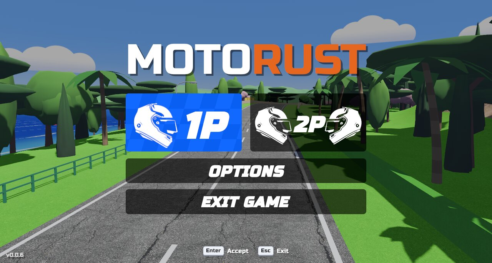

# Motorust

Arcade motorcycle racing inspired by *Moto Racer* (1997), written in Rust with
[Bevy](https://bevy.org) 0.19.



**Play it in the browser:** <https://motorust.germade.dev>

- **Three tracks.** Bahía is a Mediterranean coast road. Speed Bay is modelled
  on Moto Racer's own track and has a seafront, a tunnel, a bridge and a forest.
  Green Hill, inspired by Sonic the Hedgehog, rolls round an island of
  checkerboard hills with loops, sunflowers, totems, waterfalls and rings. All
  have steep slopes, crests and banked curves.
- **Eight bikes and riders.** You race seven AI rivals that overtake, brake
  for corners and dodge you.
- **Arcade handling.** Lean into corners at full throttle, pop wheelies, take
  short jumps and feel the suspension. Play with a keyboard, a D-pad or an
  analog stick.
- **Synthesized sound.** Engines, gearbox, wind, tyres and impacts are all
  generated in real time, with Doppler on passing rivals.
- **Everything else.** A minimap, rebindable controls and gamepad support
  (including the macOS GameController framework). It runs on Linux, Windows,
  macOS and the web.

## Quick start

You need Rust 1.95 or newer ([rustup](https://rustup.rs)) and `make`.

```sh
make install   # system dependencies (Linux) and crates
make up        # run the game
```

CI builds Linux, Windows and macOS binaries on every run (as artifacts) and
attaches them to each [release](https://github.com/germadev/motorust/releases).
The browser version is deployed to Cloudflare Pages (<https://motorust.germade.dev>).

## Controls

| Action | Keyboard | Gamepad |
|---|---|---|
| Throttle | W / ↑ | Right trigger / A |
| Brake and reverse | S / ↓ | Left trigger / X |
| Steer | A, D / ←, → | Left stick / D-pad |
| Wheelie | Space / Left Shift | B / left stick back |
| Look around | | Right stick |
| Restart | R | Select |
| Pause | Esc | Start |
| Mute | M | |
| Fullscreen | Cmd+Enter (macOS), Alt+Enter (Windows, Linux) | |

Keys and buttons can be changed in Options › Controls. The in-game menus are in
Spanish.

## Documentation

- [Playing](docs/gameplay.md): handling, bikes, menus, options and sound.
- [Tracks](docs/tracks.md): the three tracks, and how to edit one or add a new one.
- [Building and releasing](docs/building.md): native and web builds, CI and
  releases.
- [Architecture](docs/architecture.md): code map and design decisions.
- [Bikes, riders and textures](docs/models.md): the 3D models and the import
  pipeline.
- [Development record](RECORD/): what was asked and what was done, request by
  request.

## Credits

Textures are CC0 from [Poly Haven](https://polyhaven.com). The font is
[Russo One](https://fonts.google.com/specimen/Russo+One) (SIL OFL 1.1). The
bikes and riders were made by the author with [Meshy](https://www.meshy.ai).
See [assets/CREDITS.md](assets/CREDITS.md).

Motorust is a fan project. It is not affiliated with the makers of Moto Racer
or Sonic the Hedgehog, and its bikes are fictional.
