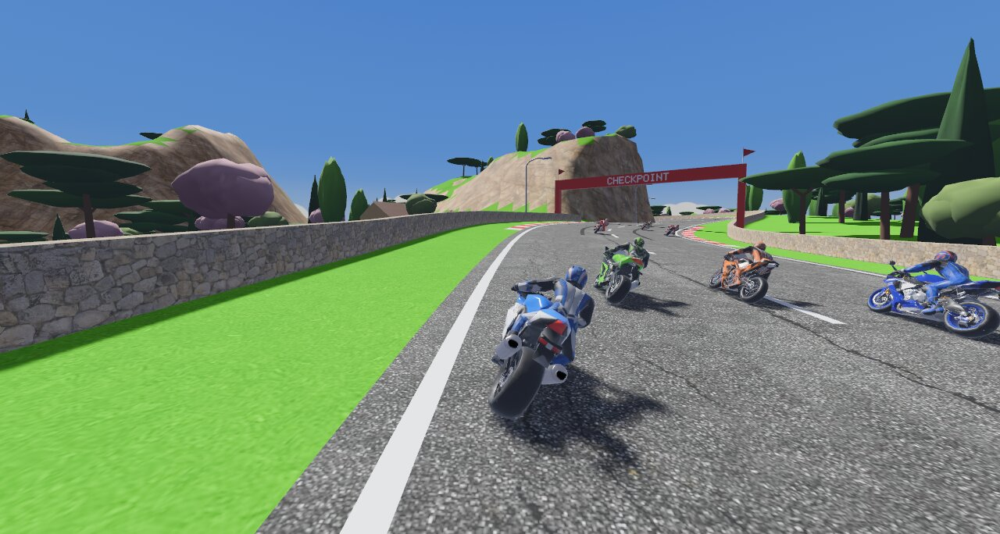
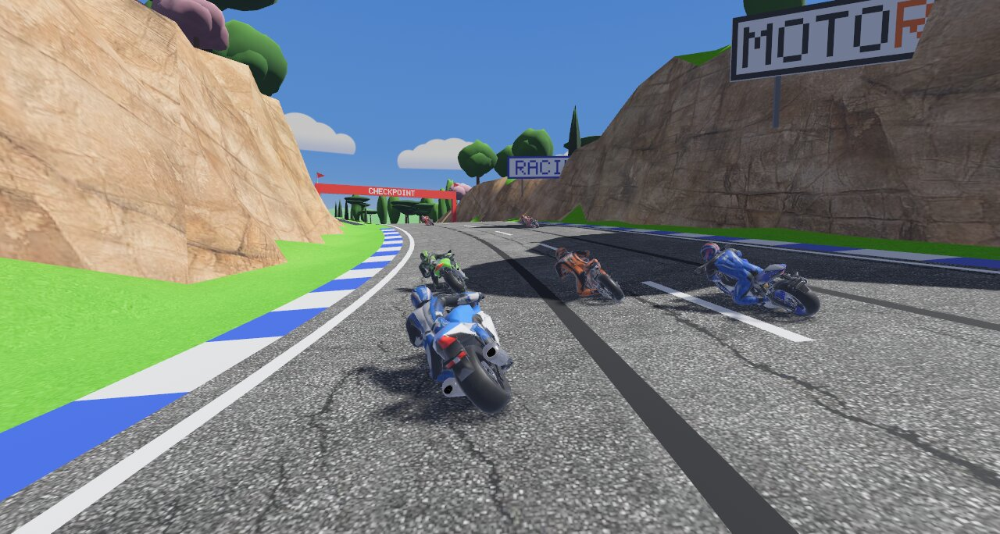
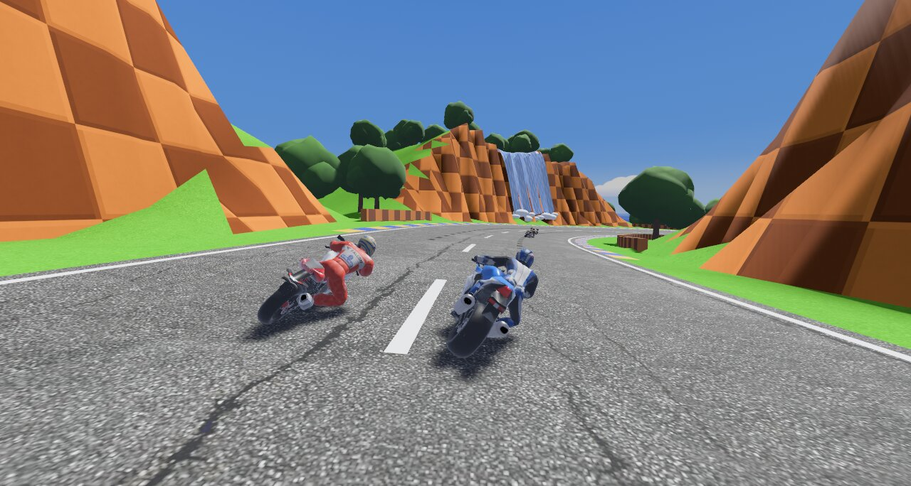

# Motorust

Arcade motorcycle racing inspired by *Moto Racer* (1997), written in Rust with
[Bevy](https://bevy.org) 0.19.


**Play it in the browser:** <https://motorust.germade.dev>

- **Three tracks** with steep slopes, crests and banked curves (see
  [below](#tracks)).
- **Eight bikes and riders.** You race seven AI rivals that overtake, brake
  for corners and dodge you.
- **Game modes.** Arcade (every track in turn, five laps each, points per
  race), free ride, a race of 1 to 9 laps (5 by default), elimination (seven
  laps on the track you choose, the last one out every lap until two race
  the last) and checkpoint (each checkpoint gantry adds seconds to the
  clock). Two players: free ride, race and elimination. Races start at
  Grand Prix lights, three difficulty levels, and once you cross the line
  the bike rides itself while the camera shows the others coming in. Best
  laps and checkpoint records are kept per track.
- **Arcade handling.** Lean into corners at full throttle, pop wheelies, take
  short jumps and feel the suspension. Play with a keyboard, a D-pad or an
  analog stick.
- **Synthesized sound and music.** Engines, gearbox, wind, tyres and impacts
  are all generated in real time, with Doppler on passing rivals, and so
  are the sea, gulls, birds and cicadas around each track while choosing the
  bike. Each track has its own song, mixed well below the engine; the menus
  have theirs, and free ride can play every track's or a chill playlist.
- **Everything else.** Two-player split screen, a minimap, controls
  remapped on a drawing of the keyboard or the gamepad (keys or buttons
  pressed together too), and gamepad support (including the macOS
  GameController framework). It runs on Linux, Windows, macOS and the web.

## Tracks

**Bahía GP** is a Mediterranean coast road between stone walls, rock cuttings,
umbrella pines and cypresses.



**Turbo Bay**, inspired by Moto Racer's Speed Bay, is a figure of eight on a
hilly island: a seafront, a tunnel that the track later passes over, a
mountain road up to a lighthouse cape, a forest and a bridge.



**Loop Island**, inspired by Sonic the Hedgehog, rolls round an island of
checkerboard hills with sunflowers, totems and waterfalls, and a branch off the
lap goes round a loop you ride upside down.



**Gold Mine** ("Mina Dorada"), after Wario's Gold Mine and Crash Team Racing's
Dragon Mines, with the roads of Moto Racer's West Way round it, is a twisting,
rolling figure of eight in a desert at dusk that crosses a mountain twice:
first through it, by lantern-lit halls of sandstone, gold-veined slate and
clay under roofs up to 34 m high, where the road splits three ways twice,
fanning out 130 m between pillars of rock, each way with its own climb or
drop; and then over it, up switchbacks and over a steel truss bridge, 70 m
above the galleries. On the way: a mining town of false fronts, dunes with a
gas station and nodding oil pumpjacks, cacti and tumbleweeds, a narrow red
canyon under a highway viaduct, an adobe pueblo, big diamond warning signs,
and a wooden bridge nearly half a kilometre long, narrower than the road, over
the red water of a flooded open pit, its benches stepping down to the water
all round.

**Tsushima Isle**, after Ghost of Tsushima, is a winding, steep figure of eight
on an island of feudal Japan that crosses the castle hill twice: first through
it, by a tunnel at the end of the castle street, and at the end of the lap
over it, through the castle. On the way: a coast road in esses, a boardwalk
across an inlet, the susuki hills at up to 10 %, a lake ringed with flowers,
a temple and the castle ridge where the road splits three ways, a red ridge
and a bamboo forest. Its own Japanese scenery is on its way.

More about each one in [docs/tracks.md](docs/tracks.md).

## Quick start

You need Rust 1.95 or newer ([rustup](https://rustup.rs)) and `make`.

```sh
make install   # system dependencies (Linux) and crates
make up        # run the game
```

CI builds Linux, Windows and macOS binaries on every run (as artifacts) and
attaches them to each [release](https://github.com/germadev/motorust/releases).
The browser version is deployed to Cloudflare Pages (<https://motorust.germade.dev>).

## Controls

| Action | Keyboard | Gamepad |
|---|---|---|
| Throttle | W / ↑ | Right trigger / A |
| Brake and reverse | S / ↓ | Left trigger / X |
| Steer | A, D / ←, → | Left stick / D-pad |
| Wheelie | Space / Left Shift | B |
| Look around | | Right stick |
| Restart | R | Select |
| Pause | Esc | Start |
| Mute | M | |
| Fullscreen | Cmd+Enter (macOS), Alt+Enter (Windows, Linux) | |

Keys and buttons can be changed in Options › Controls. The menus are in Spanish
or English: the system's language at first, changed in Options.

## Documentation

- [Playing](docs/gameplay.md): handling, bikes, menus, options and sound.
- [Tracks](docs/tracks.md): the five tracks, and how to edit one or add a new one.
- [Building and releasing](docs/building.md): native and web builds, CI and
  releases.
- [Architecture](docs/architecture.md): code map and design decisions.
- [Bikes, riders and textures](docs/models.md): the 3D models and the import
  pipeline.
- [Development record](RECORD/): what was asked and what was done, request by
  request.

## Credits

Textures are CC0 from [Poly Haven](https://polyhaven.com). The font is
[Russo One](https://fonts.google.com/specimen/Russo+One) (SIL OFL 1.1). The
bikes and riders were made by the author with [Meshy](https://www.meshy.ai).
See [assets/CREDITS.md](assets/CREDITS.md).

Motorust is a fan project. It is not affiliated with the makers of Moto Racer
or Sonic the Hedgehog, and its bikes are fictional.
