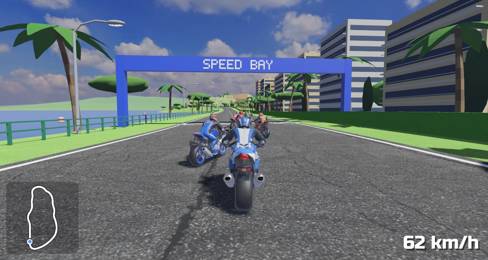

# Tracks

Motorust has two tracks, picked on the track select screen (see [gameplay.md](gameplay.md#screens)). Both are closed coastal roads with walls on both sides, slopes, crests where the bike takes off when you are flat out, and banked corners.

| Track | Length | In the game's words |
|---|---|---|
| [Bahía](#bahía) ("the Bay") | 1.6 km | "Una carretera junto al mar, con cuestas, peraltes y un salto en la recta de meta" (a seaside road with slopes, banking and a jump on the start straight) |
| [Speed Bay](#speed-bay) | 2.6 km | "La de Moto Racer: paseo marítimo con palmeras, túnel, gran hotel, bosque y puente rojo" (the one from *Moto Racer*: seafront with palms, tunnel, grand hotel, forest and red bridge) |

Distances below are in metres from the finish line, as in the track data.

## Bahía

Bahía is the first track: Speed Bay reimagined as a Mediterranean bay. It is a seaside road under a summer sky, with the sea to the west and south and mountains closing the horizon to the north-east. Its data is in `src/circuits/bay.rs`.

- **Scenery.**
  - Stone walls line the whole lap, with street lamps along it.
  - Walls of cut rock rise beside the road. On the start straight the rock is on the right and the sea on the left.
  - Umbrella pines, cypresses and olive trees.
  - Whitewashed houses and others in cream, ochre and pink.
  - Rocky outcrops inland and small islets offshore.
- **Start.** A red arch with a chequered board spans the finish line. The curbs are red and white.
- **Slopes.** About 200 m into the lap, the start straight crosses a crest where the bike jumps when you are flat out. The road then climbs to the high eastern side, about 18 m above the start, with rock on one side and a drop on the other. From there it runs back down to the finish.
- **Banking.** Corners bank according to how tight they are. This track has no extra banked spans.

## Speed Bay



Speed Bay recreates the *Moto Racer* track of the same name, taken from a recorded lap of the original game. The lap runs clockwise around a peninsula, with the sea always on the left. Slopes are what you notice most, as in the original. Its data is in `src/circuits/speed_bay.rs`. The curbs are blue and white.

A lap, in order:

1. **The seafront** (start straight). The blue "SPEED BAY" start arch spans the road.
   - On the left: a green railing with lamps, the beach, and the sea with striped buoys.
   - On the right: palm trees and tall, brightly coloured hotels behind a hedge.
2. **Down to the water and up to the tunnel** (about 300–800 m).
   - The seafront ends in a crest.
   - Next comes a steep right-hander, heavily banked, that drops almost to the water.
   - A left-hander then climbs to a rocky ridge.
   - You cross the ridge uphill through a lit tunnel, with warm walls, ceiling lights and a chequerboard strip along the bottom of the walls.
3. **The cliff and the grand hotel** (about 800–1050 m). Out of the tunnel the road drops through linked bends along a cliff. A right-hander leads to an old-style grand hotel standing on a terrace above the sea.
4. **The rock pass** (about 1080–1185 m). A narrow pass between rocks, with billboards and a red "CHECKPOINT" arch.
5. **The coast road** (about 1230–1760 m). The east coast road runs between green hills, with the sea behind a white concrete barrier. It is a roller coaster:
   - two crests where the bike jumps, the second with the sea straight ahead;
   - a dip down to the water's edge;
   - a steep climb to the forest.
6. **The forest** (about 1790–2110 m). Tall trees on both sides, a long right-hander, and a second red "CHECKPOINT" arch. The road winds down through the forest to the bridge.
7. **The bridge** (about 2170–2290 m). A bridge with red arches crosses an inlet; the sea runs in under the road.
8. **The town** (about 2350 m to the finish). The road passes a cliff on the right and then the town and its arcades, and returns to the seafront.

## Editing or adding a track

### Where tracks live

Each track is a `Circuit` in `src/circuits/` (`bay.rs` and `speed_bay.rs`). A `Circuit` has four fields:

- `name`: shown on the track select screen.
- `description`: shown on the track select screen; `\n` breaks the line.
- `layout`: the road itself (a `Layout` from `src/track.rs`).
- `scenery`: everything around the road (a `Scenery` from `src/world/scenery.rs`).

`CIRCUITS` in `src/circuits/mod.rs` lists the tracks in the order the track select screen shows them. The first one is also the default track. To add a track:

1. Create a module next to the others that defines a `pub const` `Circuit`.
2. Declare the module in `src/circuits/mod.rs`.
3. Add the track to `CIRCUITS` and update the array length.

When a different track is picked, the world is rebuilt from its `Circuit` (see [architecture.md](architecture.md)).

### Layout

`Layout` (`src/track.rs`) describes the road:

- **`control_points`**: points in metres on the ground plane (`Vec2(x, z)`), in race order. The centre line is a closed centripetal Catmull-Rom curve through all of them, resampled every 2 m. The start is at the first point, and the start straight runs towards −Z.
- **`elevation`**: the height profile, as pairs of (metres from the finish line, road height in metres). The profile is closed and interpolated smoothly between pairs. Heights are added to a base level 2 m above the sea; both tracks start the profile at 0 on the finish line.
- **`banking`**: banking comes automatically from curvature. The tighter the corner, the more the road tilts inwards, up to a fixed maximum. A `Banking { from, to, factor }` span multiplies it between two distances, still capped at the maximum. A factor above 1 banks more and below 1 banks less.

The road is 14 m wide plus curbs, and the walls stand 11.5 m from the centre line (`WALL_DISTANCE`).

The example below is illustrative and is not a real track. It shows a short loop with a crest on the start straight and an extra-banked hairpin:

```rust
use bevy::prelude::*;

use crate::track::{Banking, Layout};

const CONTROL_POINTS: [Vec2; 10] = [
    // Start straight, towards -Z.
    Vec2::new(0.0, 0.0),
    Vec2::new(0.0, -250.0),
    // Hairpin to the right.
    Vec2::new(40.0, -330.0),
    Vec2::new(130.0, -350.0),
    Vec2::new(210.0, -300.0),
    // Back straight and the last corners.
    Vec2::new(230.0, -200.0),
    Vec2::new(220.0, -60.0),
    Vec2::new(180.0, 40.0),
    Vec2::new(90.0, 70.0),
    Vec2::new(20.0, 50.0),
];

/// (metres from the finish line, height in metres).
const ELEVATION: [(f32, f32); 7] = [
    (0.0, 0.0),
    (120.0, 1.0),
    // Crest on the start straight: flat out, the bike jumps.
    (200.0, 6.0),
    (250.0, 3.5),
    (450.0, 2.0),
    (750.0, 10.0),
    (950.0, 3.0),
];

pub const LAYOUT: Layout = Layout {
    control_points: &CONTROL_POINTS,
    elevation: &ELEVATION,
    // The hairpin, with twice the banking its curvature gives it.
    banking: &[Banking {
        from: 260.0,
        to: 480.0,
        factor: 2.0,
    }],
};
```

In a real track, the layout goes straight into the `Circuit`, as in `speed_bay.rs`: `layout: Layout { control_points: &CONTROL_POINTS, elevation: &ELEVATION, banking: &[...] }`.

### Scenery

`Scenery` (`src/world/scenery.rs`) is described mostly by **spans** of the lap. A span is `span(from, to)` in metres from the finish line. It may wrap past the finish line: `span(2440.0, 300.0)` covers the end of one lap and the start of the next. `LAP` is the whole lap. `Side::Left` and `Side::Right` are relative to the direction of the race.

| Field | What it describes |
|---|---|
| `coast` | Where the sea is. Either `Coast::Function(f)`, a signed distance to the shore (positive inland), or `Coast::AroundTrack(&[(along, distance)])`, an island: land inside the loop and, outside it, out to that many metres from the centre line at each point of the lap. A negative distance brings the sea in under the road, making an inlet for a bridge. |
| `hills` | Height of the rolling hills (m). |
| `massifs` | Free-standing rock masses: `massif(x, z, radius, height)`. Also used for islets. |
| `cuttings` | Walls of cut rock beside the road: `Cutting { span, side, height }`. |
| `terraces` | Flat circular platforms at a given height, to stand a large building on. |
| `mountains` | A function for the distant mountains that close the horizon. |
| `curbs` | The two curb stripe colours. |
| `walls` | Wall style per span and side: `WallRun { span, side, style }`. `WallStyle` is `Stone` (the default everywhere else), `Concrete` (white barrier), `Railing` (green seafront railing) or `Hedge` (hedge on a low wall). |
| `tunnels` | Spans that run through a tunnel. |
| `bridges` | Spans carried by a red arch bridge. |
| `gantries` | Arches over the road: `Gantry { along, color, text }`. Without text they carry a chequered board. |
| `billboards` | Roadside signs: `Billboard { along, side, text, color, accent }`, where `accent` recolours the text from a given letter. |
| `lamps`, `palms`, `hotels` | Rows along the road: `Row { span, side, lateral, every }`, at `lateral` metres from the centre line, one every `every` metres. Hotels are tall and colourful. |
| `trees`, `forests` | Species of the scattered trees (umbrella pine, cypress, olive, broadleaf), and spans of dense forest with tall trees on both sides. |
| `houses` | `Houses { max, paints, spans }`: how many at most, their paint colours, and optionally the spans they are limited to. |
| `grand_hotel` | `Some((along, lateral))`: an old-style grand hotel at that point of the lap and signed distance from the road (positive to the left). |
| `buoys` | Positions of striped buoys in the sea. |
| `lighthouses` | Coastal lighthouses with striped towers, observation gallery and beacon: `Lighthouse { position, height }`. |
| `boats` | Sailboats and yachts anchored in the bay and open sea: `Boat { position, heading, kind }`. |
| `chevrons` | Curve warning arrow signs on sharp bends: `ChevronSign { along, side, direction }`. |
| `grandstands` | Covered spectator grandstands with crowds along the straights: `Grandstand { along, side, lateral, length }`. |
| `beach_parasols` | Striped beach umbrellas and loungers on the sand: `ParasolCluster { position, count }`. |
| `brake_markers` | Roadside braking countdown signs (100 m, 50 m) before corners: `BrakeMarker { along, side, distance }`. |

### What `cargo test` checks

Run `cargo test` (or `make test`, see [building.md](building.md)) after any change. Every track in `CIRCUITS` is checked for the following:

- **No impossible corners.** Every corner radius is more than two and a half times the wall distance.
- **No self-crossing.** Distant stretches of the track never come close enough for their walls to meet; there must be room for scenery between them.
- **Start.** The grid sits just behind the finish line, on the Z axis, facing down the start straight towards −Z. Both tracks start at the origin.
- **Rideable slopes and banking.** Slopes stay under 13 %, banking stays within its maximum, and the tight corners do have banking.
- **Terrain.** The terrain neither covers the road nor leaves a gap under it, except on bridges, and the road never touches the sea.
- **Houses.** At least half of `houses.max` find a place to stand.
- **A rival can do a lap.** An AI rival completes a lap within 90 seconds without leaving the road.
- **A flat-out lap.** Full throttle, never braking and only steering towards the road ahead, completes a lap within 60 seconds without touching the walls and stays almost entirely on the asphalt.
- **Short jumps.** Each jump lasts under 0.75 s and rises less than 1.3 m, and flat out a rival does take off over the crests (at least twice in 70 seconds).

Some tests cover a single track: for example, that Bahía has sea to the west and mountains to the north-east, that Speed Bay is a peninsula with an inlet under the bridge, and that Speed Bay's banked span banks more than its curvature alone would.
