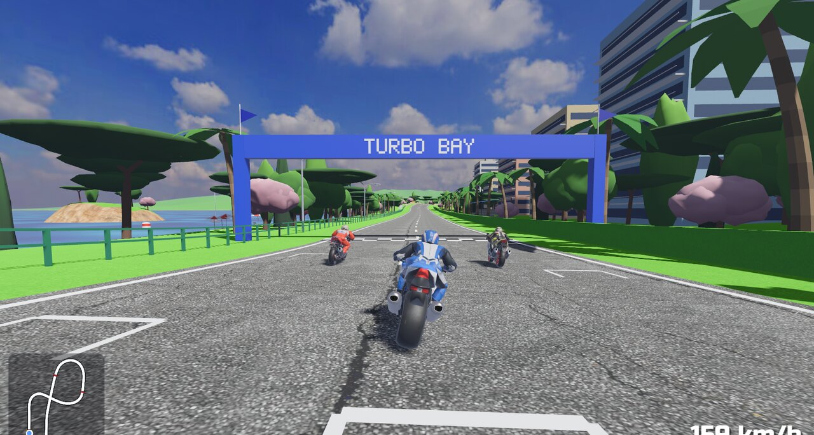
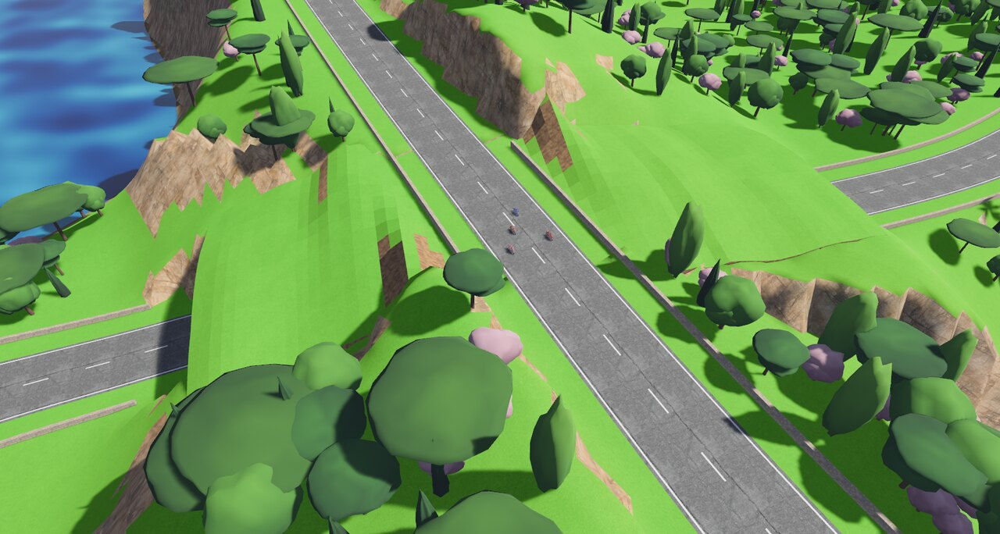
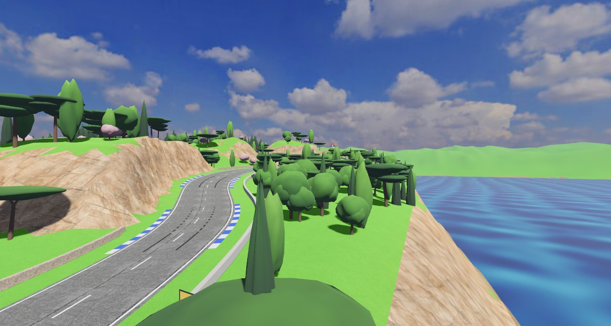
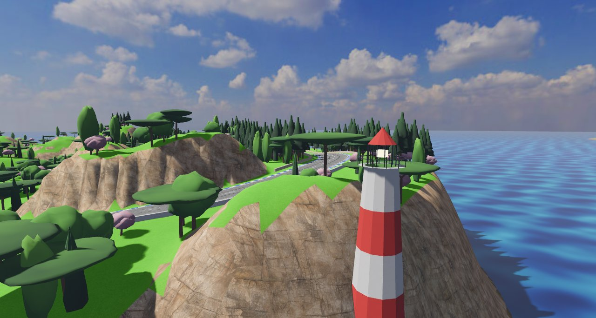
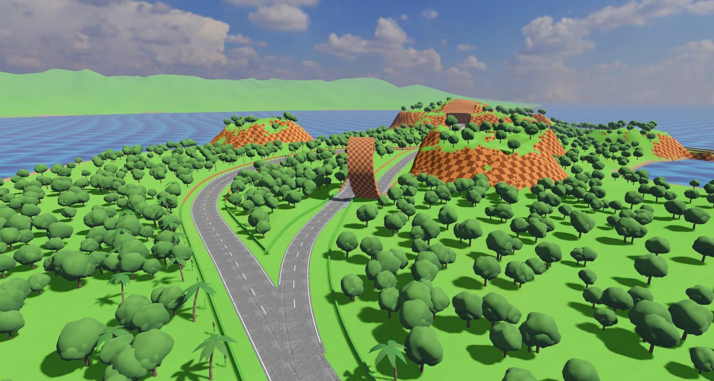
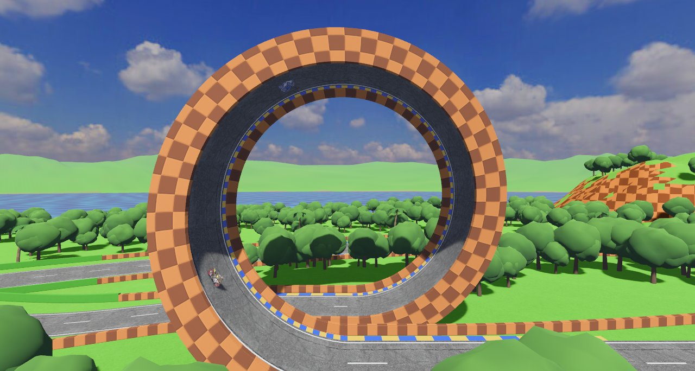

# Tracks

Motorust has eight tracks, picked on the track select screen (see [gameplay.md](gameplay.md#screens)). All eight are closed roads with walls on both sides, slopes, crests where the bike takes off when you are flat out, and banked corners: three on the coast under a summer sky, a desert mountain at dusk, an island of feudal Japan, an Earth space center & lunar base under the starry sky of space connected by an interdimensional portal, the journey of *The Fellowship of the Ring*, and the inside of a toy store, under a ceiling of lamps, the bikes as small as toys. Loop Island has a branch with a vertical loop the bikes ride upside down; Gold Mine has four branches without loops through its excavation, Ghost Island and Fellowship Road have three each out in the open, Base Lunar has a two-way crater split on its Moon sector, and Juguetería has a way through a castle and another round a loop.

| Track | Length | In the game's words |
|---|---|---|
| [Bahía GP](#bahía-gp) ("the Bay") | 1.6 km | "Una carretera junto al mar, con cuestas, peraltes y un salto en la recta de meta" (a seaside road with slopes, banking and a jump on the start straight) |
| [Turbo Bay](#turbo-bay) | 4.3 km | "Inspirada en Moto Racer: paseo marítimo, túnel bajo la propia pista, puerto de montaña y puente rojo" (inspired by *Moto Racer*: seafront, a tunnel under the track itself, a mountain pass and red bridge) |
| [Loop Island](#loop-island) | 2.4 km | "Inspirada en Sonic: un desvío con un rizo para dar la vuelta, tierra a cuadros y cascadas" (inspired by Sonic: a branch with a loop to ride, checkered hills and waterfalls) |
| [Gold Mine](#gold-mine) ("Mina Dorada") | 5.95 km | "Inspirada en las minas de Mario Kart y Crash: vagonetas, una montaña cruzada por dentro y por encima, y una corta inundada" (inspired by the mines of *Mario Kart* and *Crash*: ore carts, a mountain crossed through and over, and a flooded open pit) |
| [Ghost Island](#ghost-island) | 5.97 km | "Inspirada en Ghost of Tsushima: un castillo cruzado por debajo y por encima, cuestas, un lago entre flores y dos bifurcaciones" (inspired by *Ghost of Tsushima*: a castle crossed under and over, steep hills, a lake among flowers and two splits) |
| [Base Lunar](#base-lunar) ("Moon Base") | 4.6 km | "Centro espacial y observatorio en la Tierra con portal a la Luna: lanzadera, antenas gigantes, cúpulas de telescopio y base lunar" (Earth space center and observatory with portal to the Moon: launchpad, giant radio dishes, telescope domes and lunar base) |
| [Fellowship Road](#fellowship-road) | 5.75 km | "Inspirada en La Comunidad del Anillo: de la Comarca a los Argonath, un ocho sobre y bajo las montañas, cuestas y dos bifurcaciones" (inspired by *The Fellowship of the Ring*: from the Shire to the Argonath, a figure of eight over and under the mountains, steep hills and two splits) |
| [Juguetería](#juguetería) ("Toy Store") | 2.92 km | "Una juguetería: Scalextric sobre una silla y las mesas, un castillo, un rizo, una espiral y un tobogán" (a toy store: slot cars over a chair and the tables, a castle, a loop, a spiral and a slide) |

Distances below are in metres from the finish line, as in the track data.

## Bahía GP

Bahía GP is the first track: *Moto Racer*'s Speed Bay reimagined as a Mediterranean bay. It is a seaside road under a summer sky, with the sea to the west and south and mountains closing the horizon to the north-east. Its data is in `src/circuits/bay.rs`.

- **Scenery.**
  - Stone walls line the whole lap, with street lamps along it.
  - Walls of cut rock rise beside the road. On the start straight the rock is on the right and the sea on the left.
  - Umbrella pines, cypresses and olive trees.
  - Whitewashed houses and others in cream, ochre and pink.
  - Rocky outcrops inland and small islets offshore.
- **Start.** A red arch with a chequered board spans the finish line. The curbs are red and white.
- **Slopes.** About 150 m into the lap, the start straight crosses a crest where the bike jumps when you are flat out; it lands on the straight, well before the first bend. The road then climbs to the high eastern side, about 18 m above the start, with rock on one side and a drop on the other. From there it runs back down to the finish.
- **Banking.** Corners bank according to how tight they are. This track has no extra banked spans.

## Turbo Bay



Turbo Bay is inspired by Speed Bay in *Moto Racer*. It is a figure of eight on a hilly island, with the sea all around and two bays cutting in towards the island's waist. Its light is a clear Mediterranean summer afternoon, graded as a photograph rather than a cartoon (`SkyStyle::Mediterranean`): the greens of a Mediterranean island in summer instead of the arcade lawn (`Greens::Mediterranean`: straw-coloured dry grass, olive, sage, fresher green in the hollows and dark scrub up the slopes, in ragged patches), a deep but not vivid sky, a haze off the sea that veils the far mountains, and a warm, slightly lower sun high in the north-north-west, so the dam's face, which looks north, is in the sun. The first loop runs clockwise, with the sea on the left; the second runs anticlockwise, with the sea on the right, and climbs a mountain at the island's northern tip. Half way round the lap, the road comes back over the ridge it went through in a tunnel; at the south of the island it runs up a gorge to an arch dam, as El Atazar's, climbs away from it round a hairpin and comes down onto its crest. Its data is in `src/circuits/turbo_bay.rs`. The curbs are blue and white.

The coastline is drawn on its own (`Coast::Outline`), not as a distance from the road, so its bays, headlands and the river mouth under the bridge do not follow the track. Hills, a rocky ridge at the waist and islets offshore complete the island.



A lap, in order:

1. **The seafront** (start straight, 0–250 m, heading north). The blue "TURBO BAY" start arch spans the road, with a grandstand on the right.
   - On the left: a green railing with lamps, a beach with parasols, and the sea with striped buoys and boats.
   - On the right: palm trees and tall, brightly coloured hotels behind a hedge.
2. **Down to the water and into the tunnel** (about 250–625 m).
   - The seafront runs on level, with no crest, into a steep right-hander, heavily banked, almost at the water's edge at the north-west point.
   - The road climbs east into a lit tunnel (505–625 m) through the ridge at the island's waist.
3. **The grand hotel and the rock pass** (about 625–990 m). Out of the tunnel, past palms and an old-style grand hotel on a headland above the south-east bay, to a pass between rocks with billboards and a red "CHECKPOINT" arch (960 m), rising steadily through its bend with no crest (a bump there would throw the bike off its lean).
4. **The east coast road** (about 1000–1280 m). It runs behind a white concrete barrier, with the sea on the right. It is a roller coaster: a crest where the bike jumps with the sea straight ahead, a dip, and the start of a long climb.
5. **The mountain road and the lighthouse** (about 1280–1720 m). The road climbs on north in S-bends, with rock walls on the left and the barrier and the cliffs above the sea on the right, to its top, about 37 m above the start, with the lighthouse straight ahead below, a broad top in a bend (a crest over 600 m round: the bike stays on the road, and keeps its lean, up to some 280 km/h). Then it dives at up to 12 %, 17 m in about 200 m, straight at the lighthouse, to the foot of its tower on the low, bare northern cape, where a railing instead of the barrier leaves the whole tower in view, and round the long left-hander that turns the cape. A rocky crag stands inside the bends.
6. **The forest** (about 1660–2160 m). Back up the west side through tall trees, along the cliffs of the north bay: a climb that eases off over a broad shoulder (no crest to throw the bike off its lean in the bends) and rises again past a second "CHECKPOINT" arch (1980 m), then a right-hand kink onto the ridge.
7. **Over the tunnel** (about 2160–2450 m). The road runs down the ridge and crosses over the tunnel, about 18 m above the road inside it, on the grassy hill the tunnel goes through.
8. **The bay shore and the bridge** (about 2450–2805 m). The road runs down the shore of the south-east bay behind a concrete barrier to a bridge with red arches over the mouth of a river (2720–2805 m).
9. **The gorge** (about 2830–3020 m). The road runs south up a gorge beside the river, which is the sea's water coming up it to the foot of the dam, behind a concrete barrier over the drop to the water, with the gorge's rock wall on the left and its far wall across the river, past a third "CHECKPOINT" arch (2980 m). Ahead, filling the end of the gorge, stands the dam: an arch of concrete bowed away from the road, its face tall, nearly sheer and streaked by the damp, the crest jutting out over it on brackets, with a pool at its foot.
10. **The hairpin** (about 3020–3450 m). Below the dam the road turns off left and climbs away from it, east-north-east up the hillside above the bay, at up to 10 %, to a right-hand hairpin high over the east coast, 260 m from the dam.
11. **Down onto the dam** (about 3450–3705 m). Over the top, 50 m up, the road comes straight back down the hillside at the dam, 8 m in 200 m, the crest and the lake below in sight ahead, behind a railing that leaves the water in view.
12. **The crest of the dam** (about 3705–3860 m). Straight onto the crest, which runs as an arch 125 m in radius bowed towards the lake, level and not banked, with lamps on its parapets: on the left the lake, two and a half metres under the road, over a low parapet, held between mountains, its water mirroring the hills, the dam and the sky; on the right, behind a taller barrier, the drop down the face to the river and the gorge running off to the sea. At its far end, on the lake's side, a paved square with a monument of two concrete slabs, as at El Atazar.
13. **The town** (about 3860 m to the finish). The road comes down the far side, 40 m in 450 m, and runs north through the town between its cottages and the beach, behind a railing, onto the seafront.





## Loop Island



Loop Island is inspired by Green Hill, the first zone of *Sonic the Hedgehog*: a roller coaster of a road under a blue sky, running clockwise round an island of green hills with the sea all round. Its data is in `src/circuits/loop_island.rs`, and its landmarks are drawn by `src/world/landmarks.rs`. Riding a wheelie there, the rear wheel leaves a blue halo behind it on the road, as Sonic spinning (`wheelie_halo`, `src/bike/wheelie_halo.rs`).

- **Scenery.**
  - Every cliff, rock wall and mesa is checkerboard earth: chocolate and caramel squares under a grass top. The walls along the road are low blocks of the same earth, with hedges on the start straight.
  - Palm trees, round broadleaf trees and rows of tall sunflowers turned towards the road.
  - The loop of the branch (see below), and a giant loop on a block of checkerboard earth inland from the south shore, in the plane of the road, so you see it side on as you ride past, as in the original game.
  - Carved totem poles with eyes, beaks and wings.
  - Distant mountains across the sea to the north and west; to the south and east, open sea.
- **Start.** A blue "LOOP ISLAND" arch with a grandstand on the right. The curbs are yellow and blue.
- **A lap, in order:**
  1. **The start straight** (0–290 m), north between palms and sunflowers. A crest just past the line (about 55 m) makes the bike take off; it lands well before the branch to the loop forks off. Further up, a broad top at about 200 m (over 700 m round: the bike stays on the road even at its top speed), where the branch parts from the lap (a bike flying there would land in the branch's bend).
  2. **The first long corner** (about 300–540 m). A long right-hander climbs round the loop of the branch, then S-bends roll on east over the hills to a red "CHECKPOINT" arch (700 m).
  3. **The tunnel** (770–870 m). The road climbs through a ridge of checkerboard earth in a tunnel lined with it, its highest point, 18 m above the start.
  4. **The waterfalls** (about 880–1190 m). Out of the tunnel, a waterfall pours down the rock wall on the left into a long right-hander banked like a velodrome. The road drops past a second waterfall, on the right.
  5. **The bay** (about 1190–1700 m). The road turns right (its tightest bend, 36 m) and comes down nearly to the sea (0.8 m over it), round a round bay where the sea runs in from the east, the shore right beyond the walls on the left all round it, and a rocky islet in its middle: along its north shore, round its far end and back along its south shore, past the second "CHECKPOINT" arch (1560 m), and back up onto the old way where a wooden bridge over the inlet ended. The bay is about 180 by 105 m, more than the old inlet.
  6. **The S-bends** (about 1700–1970 m). A long, gentle rise, totem poles and the giant loop, inland on the right.
  7. **The south shore** (1980–2280 m). A beach road with palms on the sea side and sunflowers on the other, rolling gently, over a lagoon where the sea runs in under the road on **a wooden bridge** (2032–2222 m), a deck of planks on log piers with a wooden fence on each side, narrower than the road (its fences 6.5 m from the middle, the walls closing in on it over the 25 m before it), and a banked right-hander back to the start. The S-bends and the shore have no crests to fly off: in the air a bike neither turns nor leans, so a crest in a bend, or one landing in a bend, would straighten it up.
- **The branch with the loop.** On the climb to the top of the start straight (110 m), a narrower road forks off to the right. It peels away in a long, gentle right-hander (about 160 m radius), over the shoulder of the top and gently down to the mouth of a loop of checkerboard earth with a 16 m radius, heading north-east with its walls closing in. The running surface is asphalt with yellow and blue curbs, between low walls of the same earth. The bikes ride round it, upside down at the top, and come out beside the mouth, as in Sonic's loops. The road back sweeps east in wide curves (200 m and 340 m radius), climbing gently (no steeper than 5 %), and joins the lap on the S-bends (637 m). It is about as long as the lap it leaves out, and two of the rivals always take it.



## Gold Mine

Gold Mine ("Mina Dorada") is a gold mine in a desert at dusk, after Wario's Gold Mine in *Mario Kart 64* and Dragon Mines in *Crash Team Racing*, with the roads of West Way in *Moto Racer* round it: red and ochre rock, ore carts on rails, timber trestles and headframes, dunes with oil pumpjacks and a gas station, a narrow red canyon, adobe houses and big diamond warning signs. The lap twists and rolls all the way round, and is a figure of eight that crosses a mountain twice: first through it, east to west, by the galleries and halls of the mine, where the road splits three ways twice; and then over it, north to south, on a road that passes 70 m above the galleries. Its data is in `src/circuits/gold_mine.rs`; the works of the mine are drawn by `src/world/mine.rs`, its excavation by `src/world/cavern.rs`, and the roadside of the desert by `src/world/desert.rs`. Its song is "Toll of the Iron Mile". The curbs are rust red and cream; timber fences line the road, and stone parapets the rim of the pit and the switchbacks.

- **The light.** A low orange sun in the west-north-west, in front on the start straight; a violet sky, rose above the horizon and orange at it, glowing round the sun; warm, slanting light, purple shade and peach clouds. The distance melts into an orange haze (`SkyStyle::Dusk`).
- **The land.** Dry red earth on the flat, with saguaro cacti and tumbleweeds blowing across the road; low dunes of red sand north of town; in the middle of the eight, a mountain 78 m high and over a kilometre across, with smooth slopes, a broad top and shoulders the road climbs onto it on, and towers of red rock standing up from it (massifs, climbed and not, see [Scenery](#scenery)); red buttes round about and mesas with horizontal bands of red, rust and ochre rock all round the horizon; north-west of the mountain, an open pit nearly 600 m across, after the Corta Atalaya at Rio Tinto: five benches 3.4 m high, cut in steps from its rim down to a great round lake of red water, 470 m across, at its bottom, following its shore, and on up into the mountainside where it is cut into it, with spoil heaped round the rim elsewhere and a red river running out of the lake to the north (`pit` and `water`, see [Scenery](#scenery)).
- **A lap, in order** (5.95 km):
  1. **The mining town** (start straight, 0–340 m, north). A gold "GOLD MINE" arch, a grandstand, wooden houses with false fronts standing up over their roofs and porches along them, lanterns on posts, piles of crates, barrels and dynamite, and a train of three ore carts rolling up and down rails on the right. A crest at about 185 m where the bike takes off.
  2. **The dunes** (340–1000 m). A kink to the right and up onto the dunes, a straight over a blind crest (about 595 m) where the bike takes off, past a gas station on the right, with its pumps under a yellow and red canopy and a tall "GAS" sign, and oil pumpjacks nodding on the tops of the dunes either side; round a sharp left at their far end, down into a hollow and up again.
  3. **The red canyon** (1000–1655 m). South in esses between sheer red walls 36 m high, rolling up and down between 11 and 23 m, through a red "CHECKPOINT" arch (1200 m), under a concrete highway viaduct 14 m up from one wall to the other (1300 m), and under a timber trestle (1625 m) where an ore cart crosses over the road, into the east mouth of the excavation.
  4. **Through the mountain** (1655–2555 m, 900 m), west by its middle, dark but for the lanterns: down into the mine from 22 m to 5.5 m at the bottom, and up again to 21 m at the west mouth. Its walls stand straight up from the road's walls to above a rider's head and lean out a little higher; from there the roof rises in a rough arch, with domes, hollows and stalactites, to the crown of each hall. In order:
     - **A timbered gallery** at each mouth: an arched mouth framed in heavy timber, a vault about 10 m high propped every 8 m by a timber set the shape of the vault, lanterns hanging from the rafters of every other one, and planks on the ground beside the road.
     - **The first split** (1706–2056 m), in a hall of red sandstone (about 1712–1880 m, its roof up to 28 m: layered red, cream, rust and ochre rock, red gravel) and one of slate (about 1880–2050 m, the highest roof, up to 34 m: dark slate with veins of gold winding over the roof and seams of it in the walls, black gravel). The three ways fan out up to 130 m from side to side, and none runs straight through: the lap swings 26 m to the right and back across to the left; the **high road**, to the left, runs straight on where the lap swings away and then out round a wide curve, 66 m from the lap at most, over a broad hump 4.6 m above the lap beside it; the **deep road**, to the right, swings out early, 65 m from the lap, through a dip 4.2 m deep. They run side by side, each in its own gallery, between pillars of rock where the roofs come down to meet them.
     - **The timbered neck** (about 2050–2160 m), at the bottom of the mine, where the road over the top of the mountain crosses 70 m overhead (at about 2100 m).
     - **The second split** (2156–2504 m), in a hall of ochre clay (about 2162–2330 m, its walls lined with planks to 3 m, beaten earth, a roof up to 24 m) and one of sandstone again (about 2330–2500 m, up to 31 m), the first one mirrored: the lap swings left first, the **upper gallery**, to the left, swings out early over a hump 4.5 m high, and the **lower gallery**, to the right, runs straight on and out round a wide curve through a dip 4.2 m deep.

     The ways off the lap are narrower (10 m of asphalt, between walls that close in as they part from the lap), laid with planks between beams, and lit like the halls. None is clearly the quickest: flat out, a rival takes each way through a split within 5 % of the quickest. In the halls, lanterns hang on posts by the walls, one side and then the other, every 14 m along each road, and every third one high up on a tall pole, lighting the rock far above. The halls blend into each other: the roof rises and falls over some 30 m, and where one stone ends and the next begins wavers.
  5. **Along the rim of the pit** (2555–2905 m). Out of the west mouth between stone parapets, rolling along the rim of the pit past a second "CHECKPOINT" arch (2640 m), a train of ore carts on rails, a heap of ore, a "DANGER TNT" sign and a headframe whose winding wheels turn, and round to the right onto the bridge.
  6. **The wooden bridge** (2905–3425 m). From the rim straight across the flooded pit to the north-east for nearly half a kilometre, planks on log piers 18 m over the red water, narrower than the road (its fences 6 m from the middle, the walls closing in on it over the 25 m before it), the benches stepping down to it all round, with a crest in the middle (about 3230 m) where the bike takes off.
  7. **Up the switchbacks** (3425–4580 m). Up the mountain's north flank, from 18 m to 72 m, between stone parapets: off the bridge through a third "CHECKPOINT" arch (3540 m), along the shore of the lake, round a hairpin to the right and one to the left, with red diamond signs before them, over a steel truss bridge across the gully between the shoulder and the mountain (4200–4390 m), past a fourth "CHECKPOINT" arch (4440 m), and round a long sweep onto the top.
  8. **Over the top** (about 4580–5000 m), south, 75 m up, across the road through the mountain beneath, past a heap of ore and a headframe over a shaft. Over the excavation the rock that covers it carries the road, and a rocky ridge runs along it either side.
  9. **Down the esses into town** (about 5000 m to the finish). Down the mountain's south-east flank in esses at up to 10 %, with yellow and green diamond signs before the bends, through the fifth "CHECKPOINT" arch (5250 m), easing past an adobe pueblo on the outside of a bend (5450 m), with its flat roofs, beams sticking out under them, ladders and a dry tree, past a "MINE 49" sign and more piles, and a left-hander into the start straight.

## Ghost Island

Ghost Island is an island of feudal Japan, after *Ghost of Tsushima*, each of its stretches with a colour of its own, as the game paints its regions: the pink of the castle town, the blue of the coast, the vermilion of a shrine on the water, the white of the susuki grass, the flowers round a lake, the gold of a temple, a red ridge climbed through a corridor of torii, as at Fushimi Inari in Kyoto, and green bamboo. The lap is a figure of eight that crosses the castle hill twice: first through it, by a tunnel at the end of the castle street, and at the end of the lap over it, through the castle, 33 m above the tunnel. It climbs and drops hard, at up to 12 %, and winds most of the way, down the bamboo hill in a run of tight esses. Its data is in `src/circuits/ghost_island.rs`. Its song is "Blade of the Autumn Gale". The curbs are vermilion and white; stone walls line the castle street, the coast and the castle ridge, a hedge the outside of the road round the lake and a shrine's vermilion fence, low and open, its lake side, and timber fences the rest.

Its scenery is the island's own, much of it made with Meshy (see [models.md](models.md)) and the rest in code (`src/world/japan.rs`, `src/world/flowers.rs`): Japanese trees (momiji, ginkgo, sakura, black pine, sugi and bamboo), dense cedar and maple up the red ridge and bamboo down from the castle; the great torii on its islet off the coast, the castle keep on the bamboo hill on the outside of the bend past the castle, the temple and its five-storey pagoda on the outside of the bend at the end of its split, straight ahead through it, the shrine on stilts in the inlet and a bigger one on a terrace in the bamboo, thatched minka on terraces over the coast road, facing the riders coming, a log torii and a big water wheel turning on the lake's west shore, no tree standing in the way of any of them from the road coming at it; and, right by the road, stone and bronze lanterns, Jizō statues, komainu, braziers, a wayside shrine and a memorial stone, each where the walls open into a shrine's vermilion fence, so that they show whole; the corridor of torii up the red ridge; the great maple beside the road round the lake, over a clearing of red leaves ringed with logs, as in the duels of *Ghost of Tsushima*; red maple leaves blowing down the red ridge, round the great maple and over the road beside it, and white cherry petals down the castle street; and fields of flowers over most of the island (more than 60 % of its grass), after its fields in *Ghost of Tsushima* and the moss phlox round the lakes at the foot of Mount Fuji: carpets of moss phlox (shibazakura) all round the lake, magenta with drifts of pink, lavender and white, white flowers round the great maple for its reds to stand out, red spider lilies beside the castle street and on the lake's open shore, golden susuki over the susuki hills, yellow rape blossom and white flowers up the slopes over the coast road, and everywhere else broad fields of one kind each, a couple of hundred metres across, thinning out into each other: gaps of grass in drifts, more towards their borders, where islands and fingers of each reach into the next, so that no border is a line; about one in eight left to grass. Its grass is darker than the other tracks' (`grass_shade`), and so is the hedge round the lake, the moss phlox and the great maple's reds muted. Across the strait to the north stands a lone volcano, as Mount Yōtei or Fuji, its flanks carved by gullies between ridges that catch the low sun, its skyline smooth, lumpy, with a parasitic cone on the side facing the island; under dark forest, darkest at its foot, mottled by the trees' crowns, with darker stands and a few in muted autumn colours, the forest climbing its gullies; bare scree above it, in streaks; and snow on its top, lying on down the gullies in tongues, straight ahead down the castle street over the castle and behind the great torii in the sea. Its light is the golden hour of a clear autumn afternoon (`SkyStyle::GoldenHour`): the sun low in the west-south-west, lighting the volcano from the side, long shadows and cool blue shade, the sky blue overhead and warm and glowing towards the sun, a light warm haze far off, and the whole picture graded luminous and contrasted but not saturated, as Japan's landscapes look.

- **The land.** An island (`Coast::OutlineWithLakes`), with the sea right beyond the walls along the coast road, an inlet the boardwalk crosses and a lake inside it, 300 m across, with an islet in it, its shore a few metres past the road's fence; the castle hill over the tunnel, 34 m high, the tunnel opening at the foot of its slope at the end of the castle street and in rock at its other end, by the sea; the castle ridge and the red ridge east of it, the susuki hills along the east coast and the bamboo hill west of the castle, 46 m high, mountains the road climbs (massifs with `climbed: true`), each about as high as the road over its top, so that the road runs over them and along their flanks, never sunk between cut banks; crags on the red ridge and stacks of rock in the sea off the coast road; across the strait to the north, a lone volcano 900 m high, its flanks sweeping up ever steeper to a crater, snow on its top third, its foot just behind the great torii, and lower mountains round the rest of the horizon, clear of it.
- **A lap, in order** (5.97 km):
  1. **The castle street** (start straight, 0–360 m, north). A vermilion "GHOST ISLAND" arch, a grandstand and the houses of the castle town, a crest at about 185 m where the bike takes off, and straight at the castle hill, into the tunnel under it at the foot of its slope (360–620 m).
  2. **The coast** (640–1420 m). Round to the right out of the tunnel and east along the shore in esses, rolling, with the sea right beyond the wall on the left, stacks of rock in it and a fishing village by the road, its farmhouses on terraces over it; and down by the shore, where the wall gives way to a shrine's vermilion fence, towards the great torii on its islet 56 m off, its top a little under the road.
  3. **The shrine's boardwalk** (1420–1620 m). Straight across the inlet at the water's level (1.6 m over it), beside the shrine on stilts, narrower than the road (its fences 6 m from the middle, and low, 0.75 m: the shrine shows over them).
  4. **The susuki hills** (1620–2700 m). Round to the right and up in esses at up to 12 %, from 4 m to 35 m, south over their rolling top, with two crests shaped like the castle street's where the bike takes off (about 2345 and 2535 m), and down at up to 12 % towards the lake.
  5. **Round the lake** (2700–3400 m). Clockwise, round three sides of it, low (2–4 m over the water) and banked, 175 m from its middle, its shore a few metres past a shrine's vermilion fence on the right, over a strip of moss phlox down to the water and its islet, and, on the outside of the bend round the lake's foot (about 3086 m), the great maple over its clearing of red leaves, 35 m from the middle of the road behind the shrine's fence: straight ahead all the way down to the lake, leaning a little out over its clearing, its crown towards the road, on a hill rising from the road to the south shore (a massif with `climbed: true`), the clearing 9 m up and tilted up towards it so that it faces the riders, and red leaves falling thick round it and over the whole bend; then, on the west shore, a big water wheel.
  6. **The temple's split** (3414–3764 m), north, climbing at 3.4 %, in two: Gold Mine's second split (where its lap climbs too), turned north, without its way to the right, straight at the temple and its pagoda, on the outside of the bend at its end, the pagoda first, on the level of the road. The lap swings left and back across to the right through the courtyard, and the way to the left swings out early over a hump.
  7. **The corridor of torii up the red ridge** (3764–4322 m). In bends at up to 12 %, from 19 m to 53 m, most of the way (3830–4120 m) narrower than the road, its walls 6.5 m from the middle, under the corridor's gates, one every 6 m, with wide ones over the road before and after, and round to the left over the top onto the castle ridge, west.
  8. **The castle** (4322–4880 m). Down along the castle ridge at 3.4 % (steeper before and after it, so that the road splits where its grade eases), through the second split, three ways, Gold Mine's first (where its lap comes down too): the lap swings right first, the way to the left runs straight on and out round a wide curve over a hump, the way to the right swings out early through a dip; and over the tunnel through the castle hill (about 4810 m), 33 m above it, the castle keep ahead on the bamboo hill.
  9. **The bamboo** (4880–5675 m). Up the bamboo hill at up to 12 %, from 36 m to 50 m, over its top in a bend, and down it through dense bamboo in a run of tight esses, past a shrine on stilts on a terrace on the outside of a bend (about 5180 m), straight ahead coming down to it, bends of about 40 m one after the other, each the other way, winding like a river, at 11 % most of the way, to 5 m, and round to the left into the castle street.

## Base Lunar

Base Lunar ("Moon Base") starts at an Earth Space Launch & Deep-Space Observatory Complex in the coastal mountains (`0–1120 m` and `2895–4600 m`, over 61 % of the lap) under a starry night sky where the cratered Moon shines overhead (`SkyStyle::Space`), then crosses an **Interdimensional Portal (`Earth → Moon`)** at `1120 m` onto a lunar colony in Mare Tranquillitatis (`1120–2895 m`), where the blue Earth hangs in the sky instead of the Moon, before returning through a second **Interdimensional Portal (`Moon → Earth`)** at `2895 m` to Earth's high peaks (`45.5 m`) to cross 45 m above the Launch Complex Tunnel. Its data is in `src/circuits/moon_base.rs`, and its space facilities, observatory domes, lunar vehicles and stargate portals are drawn by `src/world/space.rs`. The curbs are orbital cyan and titanium white; stone parapets line the start sector and the high overpass, and concrete barriers the rest.

- **Scenery.**
  - On the Earth stretch (`x < boundary_x`, `2895–4600–1120 m`): lush countryside grass (`Greens::Countryside`) with 3D grass tufts on the shoulders, natural stratified rock cliffs, forests of broadleaf, maritime pine, poplar and tall conifers, cottages, Saturn-style space launchpads (`Rocket`) with red umbilical gantry towers, astronomical telescope observatory domes (`Observatory`) with open shutters and giant Cassegrain reflector telescopes, and giant parabolic deep-space radio antennas (`RadioDish`, `turn_dishes`) sweeping the sky. Looking up from Earth, the Moon (`moon_image`) shines in the starry sky.
  - At the realm boundaries (`1120 m` and `2895 m`): twin **Interdimensional Stargate Portals** (`Portal`) with titanium/gold-chevron outer rings, quantum energy pylons, counter-rotating cyan and violet plasma rings (`spin_portals`), and a vortex curtain through which, and only through which, the other world is seen: the Earth and the Moon never show beside each other over the walls (see `src/world/realm.rs`).
  - On the Moon stretch (`x > boundary_x`, `1120–2895 m`): cratered grey-silver lunar regolith on the flats and dark basalt rock on the steep crater walls (`Soil::Lunar`), with slate dust kicked up off the shoulders, pressurized geodesic habitat biodomes (`Biodome`), six-wheeled lunar rovers (`Rover`), solar-panel wings, illuminated station arches, and angular basalt boulders (`LunarBoulders`). Looking up from the Moon, the blue Earth (`earth_image`) hangs in the sky.
- **A lap, in order** (4.6 km):
  1. **The Earth Space Center and Observatory Mountain** (`0–800 m`, north then east). A cyan "SPACE CENTER" start arch, a grandstand, illuminated arches, an astronomical telescope observatory dome (`Observatory`) and a Saturn-V rocket on its launchpad (`Rocket`) on terraces beside the start straight, and giant deep-space radio antennas (`RadioDish`) across the hills. After a jump crest just past the line (`55 m`), the road climbs +31 m up the forested Observatory Mountain (`32 m` at `475 m`) and plunges −31.6 m down into the tunnel entrance.
  2. **The Launch Complex Tunnel and Moon Portal** (`800–1120 m`). East through the central mountain massif inside a pressurized tunnel lit by cyan-white strips (`800–1020 m`), past the first "CHECKPOINT" arch (`1090 m`), and straight through the first **Interdimensional Portal (`Earth → Moon`)** at `1120 m`.
  3. **The Lunar Truss Bridge and Maria Straight** (`1120–1920 m`). Emerging onto the grey regolith of the Moon past biodomes, lunar rovers and solar arrays, the road crosses a steel truss bridge (`BridgeStyle::Truss`, `1470–1590 m`) over a lunar rille and flies over a straightaway jump crest at `1665 m` (`20 m`).
  4. **The Sea of Tranquillity Crater Turn and Crater Split** (`1920–2895 m`). A banked 180-degree right-hand sweep round the crater floor (`8.5 m`) past a second "CHECKPOINT" arch (`2240 m`), then a climb north through the two-way **Crater Split** (`2340–2690 m`, where the left branch climbs over a high crater-rim hump) up to the second **Interdimensional Portal (`Moon → Earth`)** at `2895 m` (`42.5 m`).
  5. **The High Earth Summit, Valley Plunge and Western Mountain Ridge** (`2895–4600 m`). Back on Earth at the `45.5 m` summit, the road crosses 45 m above the Launch Complex Tunnel (`3056 m`), plunges −40 m down into the deep northern forested valley (`5.5 m` at `3555 m`) past a third "CHECKPOINT" arch (`3450 m`), climbs +30.1 m back up the Western Earth Mountain Ridge (`35.6 m`), launches over a high-altitude straightaway jump crest (`4095 m`), and plunges −35.6 m down to the finish line.

## Fellowship Road

Fellowship Road is the journey of *The Fellowship of the Ring*, its stretches in the order of the film: from a wood by Hobbiton, through Hobbiton and the Shire to Bree, over Weathertop, down through the Trollshaws to the Ford of Bruinen, along Rivendell's valley, over the pass of Caradhras and through the mines of Moria, through Lothlórien and down the Anduin between the two kings of the Argonath, past Amon Hen and, past the finish, home again, *There and Back Again*. The lap is a figure of eight that crosses the Misty Mountains twice, as the Fellowship did: first over them, by the pass, and then, turning back down round the mountain, through them, by the mines, 38 m under the pass. It climbs and drops hard, at up to 12 %, over Weathertop (51 m up) and Caradhras (49 m), winds in esses down through the Trollshaws and along the Anduin's gorge, and runs at the water's level down the middle of the river on a causeway between the kings. Its data is in `src/circuits/fellowship_road.rs`. Its song is "Beyond the Final Turn". The curbs are the Shire's green and cream; low wooden fences, which the land shows through, line the road through the wood, Hobbiton and Bree and where the small props stand by it, hedgerows the Shire's lanes, and stone walls the rest.

Its scenery is its own, made with Meshy (see [models.md](models.md#props-of-middle-earth) and `src/world/middle_earth.rs`): Gandalf's cart in the wood at the start; hobbit holes dug into the hills either side of the Water, low and high, each in a great grassy dome over its rooms, its grass coming down to the top of its door and rounded into the hillside, with a chimney, a garden before its door, washing on a line or bunting over it, the mill on the water, the Green Dragon and its sign, the party tree, Bag End under its oak up its hill; Bree's gate over the road, the Prancing Pony, a way of the road through its archway, and the town's houses; the ruins of Amon Sûl on Weathertop, broken arches and the stone trolls; in Rivendell, lamps, and at the head of its valley its halls together one over another up the rock: a pavilion by the road, the Last Homely House on a ledge over it and an elven tower on a crag over both; the Doors of Durin, open over the road into Moria, a drawing of shining silver of our own on them; a mallorn with its flet and lamps in Lothlórien; Galadriel's swan ship and an elven ship on the Anduin, the two kings of the Argonath in it, elven boats on the shore of Parth Galen and the seat of seeing on Amon Hen. The buildings by the road are turned to face the riders coming (by up to 45°) and stand on knolls a little above the road. With them, the other tracks' trees (oaks, poplars and a few dark trees in the open woods at the start and round Amon Hen, conifers through the Trollshaws and up Caradhras, ginkgos and maples in autumn colours in Rivendell, ginkgos in gold in Lothlórien), fields of flowers, the grass not green everywhere (leaves fallen under the trees of the wood at the start, Rivendell, Lothlórien and Amon Hen, and worn down to bare earth round Bree and Amon Hen, in patches with grass between them), leaves drifting down in Rivendell and Lothlórien, and the cliffs of Rivendell, green with grass and moss, with three waterfalls. Its rock is grey granite (`Soil::Granite`), its water a river's green (`Water::River`), its bridges old and weathered (`BridgeStyle::OldWooden`), and its light a summer sunset in high country (`SkyStyle::HighCountry`): the sun low and golden, the hills' long shadows over one another, a warm haze, graded as a film is, less saturated, with contrast, and bright, its highlights losing more of their colour, so that the grass in the sun is not vivid; its grass a lush land's deep greens (`Greens::Lush`).

- **The land.** Inland, with no sea (`Coast::Inland`): rivers and lakes, the land dropping to them right beyond the walls where they are near: the Water, out of the wood, 64 m wide along the left of the long sweep down into Hobbiton, square under its bridge, along the right of the sweep on and away from the road into the pool of Bywater, and out of it into the Brandywine; the Brandywine, from the north under its bridge into a pool; the Bruinen, from the mountains across the ford into a pool; Mirrormere, below Moria's west gate; and the Anduin, coming in from the south into the middle of the road, widening down the causeway, narrowing to 70 m between the kings, where the cliffs close in on it, and opening into Nen Hithoel, the lake past the kings. Weathertop, a hill the road climbs over (a massif with `climbed: true`, 68 m, rising over the road up its flank and round its top), Caradhras over the mines (44 m), the hills of Hobbiton either side of the road past the bridge, the hobbit holes dug into their flanks, Bag End's hill on the outside of the last of Hobbiton's sweeps and Amon Hen on the outside of the last bend, and rolling hills through the Shire, in the middle of the lap and round it; the cliffs on either side of Rivendell's valley, and the rock at its head its halls stand on; the cliffs of the Anduin's gorge, closing in on the river at the kings and rising sheer behind them, and either side of them, higher still, a range the river cuts through, and two rocks in the river they stand on, 23 m either side of the causeway; the Walls of Moria, sheer and higher than the doors in them, and rock round its east gate. Far off, the Misty Mountains to the east, a range of peaks up to about 1000 m under snow, and low hills round the rest of the horizon.
- **A lap, in order** (5.75 km):
  1. **The wood** (start straight, 5645–140 m, north). High over Hobbiton, 15 to 19 m up: a gold "FELLOWSHIP ROAD" arch and a grandstand among the trees, Gandalf's cart by the road, and a crest at about 95 m. An open wood of oaks, poplars and a few dark trees (a tree every 9 m in each row, against a forest's 5), the low sun reaching in between them, as Amon Hen's.
  2. **Hobbiton** (140–867 m). Every bend eased in and out. A long sweep to the right (R 180, 76°) down 16 m out of the wood, at up to 9.4 %, to the Water, 64 m wide, along the left, the mill across it; ahead through the sweep, the first hobbit holes spread round the foot of a hill past the bridge, low (their doors 5 to 9 m over the road), from ahead round to the left of the riders' view; over the water, square, on an old wooden bridge (375–455 m), narrow (its walls 6.5 m from the middle), low over it (the road at its lowest from 390 to 460 m); a sweep to the left (R 150, 73°) round that hill; ahead on the right, across the field over the pool of Bywater, the rest of the holes spread over the whole flank of another hill that faces the road, facing it, a little towards the riders coming; the holes on the left facing the riders coming; earth footpaths between them, to the mill and to the road, low bushes along them and round the holes' gardens; and a sweep to the right (R 151), ahead on its outside, across the road from the holes, the Green Dragon near the road (34 m out), raised well over it and its fence (3.7 m), facing the riders coming, and Bag End, up its hill, with the party tree past it.
  3. **The Shire** (867–1085 m). A sweep to the right and the left over the old wooden bridge on the Brandywine (885–945 m), as narrow as Hobbiton's (its fences 6.5 m from the middle), and on through its fields.
  4. **Bree** (1085–1299 m). Right and left through the town, between its palisade. Past the gate the road splits in two (1097–1526 m): ahead, on the outside of the first bend, the Prancing Pony, 1.4 times as big, its archway widened, and a way to the left through it: an S out to 52 m from the lap as the lap bends right, a straight of 45 m through the inn's archway, its walls closing in to 4 m from its middle through it, and straight on, a short cut across the inside of the lap's turn up Weathertop's flank, in one long bend to the left (R 90) onto the lap as it climbs, 35 m shorter than the lap, climbing with it at under 11 %.
  5. **Weathertop** (1299–1959 m). Its flanks rising over the road as it climbs them, grass up their slopes with the rock out between, and its top over the road round the summit straight, the ruins up on it. Up its flank at up to 12 % (7.5 % round the turn Bree's way cuts across, 10.5 % where it joins it), round to the left and the right, from 9 m to 46 m, over its top on a straight (1683–1863 m) with a crest where the bike takes off (about 1775 m), 51 m up, past the ruins of Amon Sûl up on the summit's plateau over the bank beside it (62 m from the road, 25 m over it, on ground levelled under them), a broad, diffused sunbeam down onto them, and round to the right, down.
  6. **The Trollshaws** (1959–2300 m). Down through the wood in esses at up to 12 %, past the stone trolls on the left (2095 m), a sunbeam down through the dark trees onto them, to 5 m, and round to the right, south, to the Ford of Bruinen (2300–2360 m), low over the river.
  7. **Rivendell** (2360–2819 m). South along the valley under its cliffs and three waterfalls, climbing at 3.4 %, where the road splits in two (2364–2714 m), just past the ford: Ghost Island's temple's split, turned south. The lap snakes along the valley and the way to the left swings out early over a hump. Ahead all down the valley, at its head on the outside of the bend, Rivendell's halls one over another up the rock: the pavilion to the left of the others as the riders see them, 4 m over the road, the Last Homely House on a ledge 10 m over it, and the elven tower on a ledge at the edge of the rock, 16 m over it, seen whole from the road down the valley. The low sun lights the valley only from behind as the riders come down it: a warm light, as of the evening sky, fills its halls and the rock at its head from behind the riders, and its walls up the valley from across it; and a sunbeam comes down from the sky through the clouds onto each of its halls. Its rock is not bare, as the film's green crags: grass on its ledges and gentler slopes, and moss over its faces, at the head of the valley, on its far side and down its cliffs on the right.
  8. **Caradhras** (2819–3219 m). Up in bends at up to 12 %, from 19 m to the pass, 49 m up (3155–3219 m), right over the mines. At the top of the pass, two arches of dark layered rock out of the cliff on the left, over the road, one after the other (3158 and 3191 m), the second seen through the first, each a little askew, as the sea's arches on a beach of cliffs: 17 and 19 m high over the road, their feet beyond the walls.
  9. **Down round the mountain** (3219–3790 m). On south and down, round to the left, east, north and back west, to the Doors of Durin.
  10. **Moria** (3790–4133 m). Through the Doors of Durin, open, where the road narrows (its walls 5.5 m from the middle, 3778–3810 m), and west through the mountain by its halls, dug as a mine's excavation (see [Gold Mine](#gold-mine)) but of the dwarves' masonry and natural granite caves: the way in, as high as the doors (30 m); a cave under the pass (at about 3860 m), 38 m beneath it; the Dwarrowdelf (3900–4055 m), 16 m wider than the road either side, 34 m high, past rows of great pillars, the road running between low stone walls; and a cave out to the east gate, 26 m up, down to 11 m and up again on the way, lit by lamps on iron posts.
  11. **Lothlórien** (4133–4587 m). Up and down through the golden wood, high over the land (to 30 m at 4400 m, its top, 5 m over where it comes out of Moria), where the road splits three ways (4187–4537 m), between pale walls, as of the elves' white stone (`WallStyle::Concrete`), that stand out against the gold of the wood: Ghost Island's castle's split. The lap swings right first, the way to the left runs straight on and out round a wide curve over a hump, the way to the right swings out early through a dip.
  12. **The Anduin** (4587–5235 m). Down its gorge in esses, at up to 12 % at first, the cliffs on the right, of a browner stone (to 4882 m), to the water, and west down the middle of the river on a causeway (4900–5235 m), low over the water and narrower than the road (its fences 6.5 m from the middle, 0.75 m high), in a sweep to the right and the left, between the two kings of the Argonath (about 5070 m), 60 m high, close together at the foot of the cliffs, the lake ahead.
  13. **Amon Hen** (5235–5645 m). Past the lake and round to the right over the shoulder of the hill, the seat of seeing by the road on the left (5405 m), facing it, turned a little towards the riders coming, a broad, diffused sunbeam down onto it, no trees before it, and on up onto the start straight, into the wood.

## Juguetería

Juguetería ("Toy Store") is a lap round the inside of a toy shop, the bikes as small as toys (about twelve times smaller than a real one: a chair's seat is 5.5 m up, a table's top 8 to 14 m, a tall shelving unit 39 m and the ceiling 55 m). It is short and twisting, 2.97 km, about a minute a lap, on a narrow road, a slot-car track's: its walls stand 7.5 m from the middle, not 11.5 (`Layout::wall`), the plastic running out from the asphalt to its borders with no verge, and its bends are tight, down to a 30 m hairpin, and banked as a slot-car track's banked curves are: their insides lying on the floor or the furniture, their outsides raised up to about 2.5 m on grey plastic risers (`Banking { raised: true }`). On a lap that banks so, the bank comes to its most softly and is eased over 12 points either way more (`RAISED_BANK_SMOOTHING`), all round: through esses it eases out, and off the middle of the road it rises and falls no more sharply than in the middle (a stiff bank there, stopping dead at its most, rocked the road side to side, felt as bumps). It plays with height: up a ramp onto a chair and on onto a table, across to the diorama, up a Hot Wheels helix to the top of a shelving unit, down a helter-skelter's slide to the floor, onto another table and off its edge, crossing over and under itself five times; and it splits twice, a way through a castle and a way round a loop. Ridden slower than most tracks, against the clock its checkpoints give their seconds at 80 % of the usual pace (`pace: 0.8`, see [Where tracks live](#where-tracks-live)). There is no sky: over it a ceiling of white tiles with rows of lamps, glowing, and the light from overhead, white and warm, softly filling the shade (`SkyStyle::Indoor`). Its data is in `src/circuits/toy_store.rs`, its centre line, height profile and branches worked out by `tools/toy_store_layout.py`; the room and all that stands in it are drawn by `src/world/toys.rs`, some of its toys modelled with Meshy (see [models.md](models.md#toys-of-the-toy-store)). Its song is "Plastic Velocity Rush". The curbs are a slot-car track's red and white.

- **The room.** A floor of wooden boards (`Soil::Floor`, flat, with no rock, sand nor grass), and round its walls shelves 43 m tall under bands of colour, in bays of a department each, painted its colour at the back, along the boards' edges and on a sign over the bay: boxed toys, a few kinds to a shelf, each kind in a row of its own boxes, some sold out (sixteen fronts: windows showing a figure, a car or bricks, dolls' boxes, jigsaws, board games, cartons, white boxes in any colour, space toys, polka dots); dolls in tall pink and lilac boxes; jigsaws and board games lying flat in piles; big boxes two shelves high; bears and rabbits sitting in rows; balls in rows over a wire cage full of them; and small toys in blister packs on the hooks of a pegboard. In the south wall, the shop's front of glass (176 m long and 40 m high, the shelves stopping short of it either side), right ahead of the bikes coming down the east side and along the train table, which runs them up to within 12 m of it, the doors ahead on the left, and along the left of the road round it, close by: aluminium framed, sliding doors in its east end under the box of their works and a green exit sign, a mat and the alarm's gates inside them; and through it, in the daylight, a pavement under a canopy, a car park with its bays (the two in front of the doors blue), cars parked in most, a zebra crossing from the doors and lamp posts down the rows, trees along a verge, a street and buildings across it and down either side, under a blue sky with clouds (`src/world/shopfront.rs`: twelve times life size, as the toys make everything else, a car 54 m long; lit by a sun of its own, worked into its colours, and clear of the shop's haze, so brighter than the shop as daylight is through its windows). In it: a red chair; the first table, of green felt, two pushed together; a long diorama table whose top is a green baseplate of plastic bricks, studded, with two castles on it; a tall white shelving unit, its shelves of boxed toys on both sides; a yellow table with an electric train of crates going round its oval right by the road along it (its track 8 m from the road's walls); and, beside the start straight, a low table of blue sea with a pirate ship on it, its bow to the start, and a rubber duck afloat. Around the floor, an electric train of coaches going round its oval on a blue rug by the road down the east side, a mat of foam tiles in bright colours, beach balls, stacks of lettered wooden blocks and stacks of tyres round the outside of the floor's corners. Meshy's toys stand by the road, just past its borders: a tin robot and a teddy bear by the start straight, turned to the bikes coming, a duck and her two ducklings by the last straight going the bikes' way, three spinning tops among the esses on the first table, two round towers under red roofs where the lap comes onto the diorama, over the floor's roads two biplanes and a helicopter hanging from the ceiling on their strings, their undersides 16 to 20 m up, a plush giraffe 30 m tall south of the north wall's road, a fire engine at the north-east corner facing the road, a crocodile monster truck by the start straight facing it as if to race, a doll's house inside the last bend, its front to the home straight, a mechanical pegasus on the first table by its hairpin, two nutcrackers on guard either side of the road where it comes off the slide, a garage playset by the road down the east side, a rocking horse by the start straight, side on to it, a tyrannosaurus 17 m tall beside the home straight, its head reaching out 3.6 m over the road at more than 11 m, a rocket by the road to the chair, a teepee and a toy chest, its lid open, by the start straight, a dump truck by the north wall's road, a jack-in-the-box and a xylophone on the floor by the start straight, a giant robot 26 m tall standing guard inside the shop's doors, and by them the checkout counter, a row of nested shopping trolleys and two potted plants; and, on the floor train's oval, a railway station with its platform along the track and, on the other straight, a mountain the train runs through by its tunnel. And plastic building bricks as big as the diorama's studs (1.2 m apart, a brick 1.44 m high, glossy, in bright red, blue, yellow, green, white, orange and grey: `src/world/bricks.rs`): a village of six little houses on the diorama round its castles, turned to the road, their walls in a running bond with a door and windows, under roofs stepping up to their ridges; towers of bricks stacked crosswise by the start straight, on the first table and on the train table; heaps of bricks spilled on the floor by the road (inside the north-east corner, by the road to the chair, beside the start straight and by the road down the east side), most lying flat, a few on their sides and some stacked; and low walls of bricks along the road round the north-east corner, under the first table and down the east side, and round the last bend. The tables stand on their legs clear of the roads running under them: a leg that would stand on one moves along the table's side until it does not.
- **The toy tracks.** Where the road runs over the furniture or the floor, it is a toy track's, each with its own deck and supports (see `BridgeStyle` below): a slot-car track (dark plastic with two slots and their silver rails, between red and white borders) lying on the chair and the tables, on the floor, or carried over it on blue lattice towers; Hot Wheels' orange track (with chevrons and raised orange edges, a little light every few metres along their tops) on blue pillars, along the drag strip, up the helix, hanging off its blue column round it, and on the way round the loop; and the slide's chute, yellow between tall red sides, on red posts and brackets off its tower. In the bends on the floor and the furniture the slot-car track banks as much as a road may, its inside staying where it lies and its outside raised on grey plastic risers, wedges every 10 m from what it lies on up to its deck; off the bridges, on the floor, its deck is drawn there too, so that its raised outside shows how thick it is. The ways off the lap lie level, and so does the lap beside them. Where a stretch runs under a table or another stretch (the `tunnels`), nothing is drawn but what stands over it.
- **The castle.** On the diorama, a way to the left (`Branch` without a loop) runs through a castle of grey bricks under red roofs: out from the lap in a gentle S (bends of 100 m), straight in at the gate of its near end, under a gatehouse of two round towers and a battlemented bridge 10 m over the road, between its walls and out at the gate of the other end, and back onto the lap in another gentle S, 26 m from the lap at its furthest. The lap swings out the other way round it in the same S, its mirror image, so that neither way is the longer (each 184 m, 3 m more than straight on) nor the slower. Built in code round the road (`Castle { kind: CastleKind::Through }`); the castle further along, Meshy's (`CastleKind::Big`), faces the lap, and two of Meshy's towers (`CastleKind::Tower`) stand either side of the lap where it comes onto the diorama.
- **The loop.** Along the north wall, the way to the right (`Branch` with a `VerticalLoop`) goes straight on into a loop of Hot Wheels' orange track, 14 m in radius, on a blue stand, the ways in and out of orange track too, while the lap swings 16 m away to the left, toward the wall, and back: the way round the loop makes no detour but the loop itself, and a good rider takes about as long either way. On the way in, and on the lap beside it as far along, a Hot Wheels booster each (`VerticalLoop::boosters`): narrow red pods on the walls' line, a black wheel spinning in each at the road's edge, an arch of yellow and black chevrons over the road and yellow chevrons on it, driving the bikes on up to 270 km/h (`src/world/boosters.rs`).
- **A lap, in order** (2.92 km):
  1. **The drag strip** (start straight, 2928–130 m, north). Hot Wheels' orange track on the floor, under a blue "TOY STORE" arch, with a booster's kicker (about 75 m) the bike takes off over, and on under the diorama table the lap crosses on top later (110–180 m).
  2. **The chair and the first table** (170–650 m). Round to the right onto a slot-car track, up a ramp onto the chair's seat (5.5 m up, a jump onto it), on up another ramp onto the first table (14 m), in esses across it and round its far end in a hairpin, past a yellow "CHECKPOINT" arch (635 m).
  3. **The diorama** (650–1053 m). Across the gap onto it, as high, swinging out to the right round the castle while the way through it runs to the left (730–914 m), then swinging right and left over the start straight below.
  4. **The Hot Wheels helix** (1053–1335 m). Orange track, banked steeply (up to about 23°), climbing a turn and a quarter to the right round a blue column, evenly, at about 8 %, to the top of the tall shelving unit (39 m), near the ceiling's lamps. It grips 2.4 times as hard across (`Banking::grip`, `Track::grip_beside`), so that it is climbed flat out though only 36 m round; the rivals reckon with it (their steering), planning their speed with up to 1.6 times (`PLANNED_GRIP`: their steering turns in late into a bend that tight taken flat out).
  5. **Along the top of the shelves** (1335–1427 m), a slot-car track again, past a second "CHECKPOINT" arch (1381 m).
  6. **The slide** (1427–1883 m). A helter-skelter's chute, banked, two turns and a quarter to the right round its striped tower, down to the floor at about 8 %.
  7. **The north wall** (1883–2203 m). East along the floor, a row of wooden toy blocks on the left, the way round the loop straight on to the right (1918–2164 m), the lap swinging away toward the wall, a booster on each.
  8. **Under the first table** (2203–2453 m). Round to the right and south under the table, past a third "CHECKPOINT" arch (2303 m) under it, and in esses down the east side.
  9. **The train table** (2453–2833 m). Up a ramp onto the yellow table (9 m), straight on at the shop's glass and its doors, round to the right 12 m short of it and in esses along it, its own electric train right by the road on the right, and straight off its edge down a ramp back to the floor.
  10. **Home** (2833 m to the finish). Round to the right, round a stack of blocks, onto the drag strip.

## Editing or adding a track

### Where tracks live

Each track is a `Circuit`, written in RON in `assets/circuits/` (`bahia.ron`, `turbo_bay.ron`, `loop_island.ron`, `moon_base.ron`, `gold_mine.ron`, `ghost_island.ron`, `fellowship_road.ron` and `toy_store.ron`), with the functions of its terrain it names (its coast or water; the gullies of Ghost Island's volcano) in `src/circuits/` (`bay.rs`, `gold_mine.rs`, `ghost_island.rs`, `fellowship_road.rs`), and the tests of the circuits (`loop_island.rs` and `moon_base.rs` only tests). A `Circuit` has seven fields:

- `name`: shown on the track select screen.
- `description`: shown on the track select screen; `\n` breaks the line.
- `song`: the music for the race, an MP3 in `assets/music/` embedded with `include_bytes!` (a file names it, as `song: (file: "bahia.mp3", length: 178.4, loudness: -16.1)`, and `music` in `src/circuits/mod.rs` builds it in), its `length` in seconds (as `ffprobe` gives it) and its `loudness`: the integrated loudness (LUFS) of its first two minutes above 500 Hz, which `ffmpeg -t 120 -i song.mp3 -af highpass=f=500,ebur128 -f null -` prints as `I:` in its summary. The game turns each song up or down by the difference so they all sound equally loud over the engine (whose drone covers the lower notes), and well under it.
- `ambience`: what its surroundings sound like on the bike select screen: how much sea, seagulls, small birds, cicadas and wind (0 to 1 each).
- `pace`: how fast the track is ridden against most (1): against the clock, the checkpoints of a slower one, narrow and twisting, give their seconds at that much of the usual pace (`CheckpointTimes::at`), so that a good ride earns as much on it as on the others (Juguetería's is 0.75; every other track's 1).
- `layout`: the road itself (a `Layout` from `src/track.rs`).
- `scenery`: everything around the road (a `Scenery` from `src/world/scenery.rs`).

`FILES` in `src/circuits/mod.rs` lists the tracks in the order the track select screen shows them; the game reads them once, as it starts, into the `Circuits` resource (`Circuits::load`), and the systems take them from it (`Res<Circuits>`, the one chosen `circuits.get(*current)`). The first one is also the default track. To add a track:

1. Write its file in `assets/circuits/`, as `bahia.ron`, and add it to `FILES` in `src/circuits/mod.rs`, where it goes in the menu, updating the array length.
2. If it has a coast or water of its own (or a volcano's gullies), write their functions in a module next to the others, declare it, and name them in `terrain_function` (`src/circuits/mod.rs`); its song, in `music`. A circuit with no water, indoors, names `dry`. Its mountains are shapes in its file (see `mountains` under [Scenery](#scenery)).

#### Circuits in RON

A circuit's file has the fields of `Circuit`, `Layout` and `Scenery` by their names, as the Rust does; `src/circuits/data.rs` reads it. The lists the scenery leaves out are empty, and its `Option`s `None`. What is not plain numbers, lists and structs:

- a colour as its sRGB: `(0.85, 0.08, 0.06)`;
- a point as `(x, z)`;
- a stretch of the lap as `Span(40.0, 340.0)`, or `Lap` for all of it;
- a prop (of feudal Japan's or Middle-earth's) by the road as `(model: Pagoda, spot: Road(along: 3780.0, lateral: -34.0))`, over it as `Over(along: …)`, anywhere as `At(position: (x, z), heading: h)`, with `scale`, `turn`, `lean` and `facing_riders` if wanted;
- the terrain's functions by name, as `coast: Function("bay_coast")`: they stay in Rust, named in `terrain_function` (`src/circuits/mod.rs`);
- the mountains as shapes with their parameters, as `Range(center: (280.0, -300.0), near: 1700.0, far: 2600.0, relief: (low: 84.0, high: 240.0, scale: 280.0, octaves: 4))` (see `mountains` under [Scenery](#scenery)).

A file has no constants: where the Rust named a stretch once and used it often (`CREST`, `TUNNEL.from + 60.0`), the file writes the numbers, and says in a comment at its top where things are (as `turbo_bay.ron` does).

A field the game does not know is refused: `every_circuit_file_reads` (`cargo test`) reads every file, so a mistake fails there and not in the game. In a desktop development build (`cargo run`) the file is read from the disk, so a change shows with a restart, without compiling; a release build and the web carry the files built in.

When a different track is picked, the world is rebuilt from its `Circuit` (see [architecture.md](architecture.md)).

### Layout

`Layout` (`src/track.rs`) describes the road:

- **`control_points`**: points in metres on the ground plane (`Vec2(x, z)`), in race order. The centre line is a closed centripetal Catmull-Rom curve through all of them, resampled every 2 m. The start is at the first point, and the start straight runs towards −Z.
- **`elevation`**: the height profile, as pairs of (metres from the finish line, road height in metres). The profile is closed and interpolated smoothly between pairs. Heights are added to a base level 2 m above the sea; every track starts the profile at 0 on the finish line.
- **`banking`**: banking comes automatically from curvature. The tighter the corner, the more the road tilts inwards, up to a fixed maximum. A `Banking { from, to, factor, raised }` span multiplies it between two distances, still capped at the maximum. A factor above 1 banks more and below 1 banks less. The road banks about its middle, its inside dropping as its outside rises; where `raised` (`false` on every track but Juguetería), it banks as a toy track's banked curve on its supports does instead: its inside wall stays where the road would lie level and the rest of it rises, its middle raised by as much as its inside would sink (`Track::lift`), eased in and out over some 80 m either side, so that its grade changes gently and nothing takes off over it. Indoors the floor stays flat under a raised bend, as under the road lying level, and the world draws risers under its outside (see the toy tracks under `bridges`). A road off the lap lies level where the lap beside it banks raised, and where it is set level (`factor` 0), so that the two ways are alike.
- **`branches`**: alternative routes off the lap, each with a loop the bikes ride (see [Branches and loops](#branches-and-loops)). Most tracks have none: `branches: &[]`.
- **`narrows`**: stretches where the walls close in closer than the edge of the asphalt, as on the wooden bridges of Gold Mine and Loop Island, Ghost Island's boardwalk and corridor of torii, or the crest of Turbo Bay's dam, narrower than the road: `Narrowing { from, to, wall }`, the walls `wall` metres from the centre line between `from` and `to`, closing in over the 25 m before and opening out over the 25 m after (`NARROW_EASE`). The road counts as ending half a metre short of them (for the grass, the rivals' lines and where a fallen rider rejoins). Most tracks have none: `narrows: &[]`.

- **`wall`**: how far the walls stand from the centre line where nothing closes them in: `WALL_DISTANCE`, 11.5 m, on most tracks; less on a narrow one (Juguetería's 7.5 m), whose asphalt is then half a metre short of them, as where they close in (`narrows`). The roads off the lap are no wider than the lap there, the tightest bend allowed and how far apart distant stretches must keep go by it (see [What `cargo test` checks](#what-cargo-test-checks)), and the arches over the road stand just past its walls.

The road is 14 m wide plus curbs (less on a narrow track), and the walls stand 11.5 m from the centre line (`WALL_DISTANCE`) unless the layout's `wall` says otherwise.

The centre line may cross itself only where one stretch goes through a tunnel and the other passes well above it, at least 12 m higher, as in Turbo Bay. The physics follows each bike, its rider and the rivals on the stretch at their own level (`Track::nearest_at`), and the scenery takes care of the rest (see `tunnels` below).

The example below is illustrative and is not a real track. It shows a short loop with a crest on the start straight and an extra-banked hairpin, as a circuit's file writes its `layout`:

```ron
layout: (
    control_points: [
        // Start straight, towards -Z.
        (0.0, 0.0),
        (0.0, -250.0),
        // Hairpin to the right.
        (40.0, -330.0),
        (130.0, -350.0),
        (210.0, -300.0),
        // Back straight and the last corners.
        (230.0, -200.0),
        (220.0, -60.0),
        (180.0, 40.0),
        (90.0, 70.0),
        (20.0, 50.0),
    ],
    // (metres from the finish line, height in metres).
    elevation: [
        (0.0, 0.0),
        (120.0, 1.0),
        // Crest on the start straight: flat out, the bike jumps.
        (200.0, 6.0),
        (250.0, 3.5),
        (450.0, 2.0),
        (750.0, 10.0),
        (950.0, 3.0),
    ],
    wall: 11.5,
    // The hairpin, with twice the banking its curvature gives it.
    banking: [(from: 260.0, to: 480.0, factor: 2.0)],
),
```

The lists it leaves out (`branches`, `narrows`) are empty; `turbo_bay.ron` has narrows, `loop_island.ron` a branch round a loop, `gold_mine.ron` branches without one, and `toy_store.ron` all of them, written by `tools/toy_store_layout.py`.

### Branches and loops

A `Branch` (`src/track.rs`) is a road that forks off the lap and joins it again further on, with a vertical loop in the middle:

A branch may also have no loop (`vertical_loop: None`, `exit: &[]`): then it is another way along the lap, through the control points of `approach`, as in Gold Mine's excavation.

- **`from`, `to`**: where it leaves the lap and where it joins it again, in metres from the finish line. Pick straight, gentle stretches of the lap.
- **`approach`**: control points of the road from the fork to the loop, and **`exit`**: those of the road from the loop back to the lap. Each road is an open Catmull-Rom curve, like the centre line of the lap. It starts on the lap's centre line, going its way, and ends on it; give points along a smooth curve that peels away (an arc a dozen metres apart works well). The last 50 m into the loop and the first 50 m out of it are added for you, straight along it.
- **`vertical_loop`**: `Some(VerticalLoop { mouth, heading, height, radius, shift, boosters })`, or `None` for a branch without a loop. `mouth` is where the bikes go in (the middle of the running surface at the bottom), `heading` the way they go in and come out, `height` the height of the road there (like the heights of `elevation`), `radius` that of the running surface, and `shift` how far to the left (negative: to the right) the way out is from the way in. The running surface drifts sideways as it goes round so that it does not run into itself; the shift must be more than the width of the running surface. With `boosters`, the way in has a Hot Wheels booster on its straight lead, and the lap beside it another as far along, so that neither way gains by them: while on one, a bike on the ground is driven on hard (`Ground::booster`) up to `BOOSTER_SPEED` (75 m/s), and never slowed (`false` on every track but Juguetería).

The roads off the lap are narrower than the lap (10 m of asphalt plus curbs). Their walls are never further out than the lap's: on a narrow track (`wall`), as far as the lap's, and they part from it twice that far from its centre line. While a branch shares the lap's road, it lies on the lap's surface, so the two are one road, with the lap's walls; once its walls part from the lap's, it goes over to its own height and banking. Its own height runs smoothly along it: from the lap's height and grade where it parts, it climbs or drops to the height of the loop, which it reaches level 25 m before the mouth (and leaves level 25 m after the way out), spread over all the road in between, with no ramps or dips. So that the turn off the lap is gentle, fork where the lap is straight and give the road room to peel away: it shares the lap's road (and its crests) until it is about 23 m from the lap's centre line. Its walls close in to the running surface of the loop over the last 70 m before it, and open out again after it. Where the two roads meet, neither draws walls, lines or curbs on the other's road.

A branch without a loop runs at the height of the lap's surface beside it, higher or lower by its **`rise`**: pairs of (metres along the branch, metres above the lap beside it), through which the difference runs smoothly (Hermite with Catmull-Rom tangents), none at its ends; `&[]` for none. (Far from the lap, where its nearest point moves along the lap's centre line in fits and starts, how far along the lap it is beside is smoothed over 8 points either side first; and once its walls have parted from the lap's, it goes over, by 45 m further away, to the height of the lap as far along it as it counts as, which runs on steadily however much the lap winds.) It has its own banking once apart. Keep a rise to where the branch is well apart from the lap, 30 m or more from the lap's centre line, where it has a surface all its own, and keep its crests gentle: Gold Mine's are broad-topped humps and dips with gentle edges (sharp in the hollows, where nothing takes off), 4–5 m over some 180 m, with no crest sharper than about 0.003 1/m and grades under 11 % where the lap beside it climbs or drops at about 3.5 %. Flat out, the bikes ride through a split near their top speed, so which way is quicker is mostly a matter of how long each way is and how sharply it bends, not of its climbs: in Gold Mine all three ways are about as long, and none runs straight through: at each split the lap swings one way and back, one branch runs straight on where the lap swings away before curving out, and the other swings out early. Its walls are as wide as the lap's while the two share the road, and close in to 8.5 m from its centre line (or stay at the lap's own, on a narrower track) as it parts from the lap, so that past about 35 m from the lap there is rock between the two (past twice the lap's walls and 10 m more, on a narrow track); closer still where its **`narrows`** say (`Narrowing`s as the lap's, `from` and `to` in metres along the branch, the walls closing in over 25 m before and opening out over as many after), as through an archway; `&[]` for none. Leave and join the lap gently: its first control point a metre or two from the lap's centre line, 15 m along, and its last likewise before the join. A bike is on whichever road's centre line is nearest, so the walls of each road are the edges of the rock between them. Rivals that take the branches with loops take every branch without one too; the others take one on the side of their lane, 2 m or more to that side of the middle (see `Rival::takes` in `src/bike/ai.rs`). Over the last 120 m of a branch, a rival gives way to any bike on the lap about level with it and near the line it will join the lap on, dropping in behind it. Each rival sees the others across the road it rides itself, so one coming off another road where two meet is seen where it is.

Round the loop (`src/bike/loop_ride.rs`), a bike rides on the running surface: steering turns it on the surface as on the road and takes it across it, and the walls along its edges (at the same distance from the middle as the walls at the mouth) keep it on it, though nobody falls against them. Riding straight on, the surface carries it round and sideways by the shift, out beside the mouth. Other bikes are left out. Its speed comes from the engine, the brake and the resistances as on the road, plus the part of gravity along its way. Too slow to reach the side, it comes back down and can reverse out of the mouth; past the side, too slow for the surface to hold it, it falls off and drops to the road below, with its rider. It comes out pointing the way it was. The chase camera turns over with it and follows it as it turns.

### Scenery

`Scenery` (`src/world/scenery.rs`) is described mostly by **spans** of the lap. A span is `span(from, to)` in metres from the finish line. It may wrap past the finish line: `span(2440.0, 300.0)` covers the end of one lap and the start of the next. `LAP` is the whole lap. `Side::Left` and `Side::Right` are relative to the direction of the race.

| Field | What it describes |
|---|---|
| `coast` | Where the sea is. One of: `Coast::Function(f)`, a signed distance to the shore (positive inland); `Coast::AroundTrack(&[(along, distance)])`, an island with land inside the loop and, outside it, out to that many metres from the centre line at each point of the lap (a negative distance brings the sea in under the road, making an inlet for a bridge); `Coast::Outline(&[Vec2])`, an island whose shore is a smooth closed curve through the given points, drawn like the centre line, with its own bays, headlands and inlets (draw an inlet under a bridge to bring the sea in under it); `Coast::OutlineWithLakes(&[Vec2], f)`, the same island with lakes inside it, `f` the signed distance to their shores (negative in the water), as at Ghost Island; or `Coast::Inland(f)`, inland, with no sea, `f` the signed distance to the shores of its rivers and lakes, as at Fellowship Road. On an island, and inland, the land drops to the sea (and to the lakes and rivers) right beyond the walls where the shore is near; with `Coast::Function`, only further off. |
| `hills` | Height of the rolling hills (m). |
| `greens`, `grass_shade` | How the grass is coloured, each track its own: `Greens::Lawn`, the arcade lawn, a bright green a little lighter or deeper here and there (the coastal tracks); `Greens::Mediterranean`, a Mediterranean island's in summer: swathes of straw-coloured dry grass, olive and grey-green sage with patches of straw and dark scrub and a fine mottling, all on a warped field so no edge runs straight, fresher in the hollows and by the water, drier up high and towards the sun, scrub up the steep slopes and bare earth on the steepest (Turbo Bay, whose tints are worked out over the grass photo's own colour, so its `grass_shade` is 1); or `Greens::Countryside`, many greens: broad swathes of fresh, yellow, olive, deep and bluish greens, lusher by the water, drier and yellower on the heights and the slopes turned to the sun, and the dark green of conifer forests up the hills, over the land far from the roads and on the mountains across the sea (Ghost Island); or `Greens::Lush`, a lush green land's: the countryside's, its forests as they are, but its grass deep, rich and green, little red and less blue in it, not yellowed nor paled by the sun (as the Shire's at Matamata, about sRGB 80, 125, 35 in the sun), and darker in drifts some tens of metres across where it grows thick (Fellowship Road, the Shire's). And how light it is: 1 as painted, less for darker, less vivid greens (0.36 at Ghost Island, 0.55 on Fellowship Road); the grass in flower darkens half as much, and the hedges as much as the grass. |
| `massifs` | Free-standing rock masses: `(center: (x, z), radius: r, height: h)`, rising sheer right behind the walls of any road near them. Also used for islets. With `climbed: true` it is a mountain the road climbs instead: smooth slopes with a broad top that are the ground itself, the road cut into them or built up to them within 30 m of its flat verges (and round a tunnel through it, at once, as steeply as rock). |
| `cuttings` | Walls of cut rock beside the road: `Cutting { span, side, height }`. |
| `terraces` | Circular platforms at a given height, to stand a large building on, level or sloping one way: `Terrace { center, radius, height, tilt, skirt }`, `tilt` how much higher it stands per metre along x and z (Ghost Island's clearing under the great maple rises away from the road, to face the riders), the ground blending back into the land over `skirt` metres past the edge (wider where the land round it stands far above or below it, so the bank stays grass instead of breaking into a cliff). |
| `mountains` | The distant mountains that close the horizon (`src/world/mountains.rs`), the highest of their shapes at each point, none if left out: `Range(center, near, far, relief: (low, high, scale, octaves, offset, power))`, rolling peaks rising from `near` metres from `center` to their full height at `far`, all round it or, with `toward: Some((x, z))`, past a line through it square to that way; with `ragged` (`amount`, `scale`, `octaves`) its edge wandering, `facing` (`direction`, `from`, `to`) only the way it faces, `clear_of` (`center`, `radius`, `from`, `to`) none round a point, `mesas` (`from`, `to`, `scale`, `octaves`) flat-topped mesas; and `Cone(center, radius, height, steepness, crater, rim, relief)`, a lone peak with a crater at its top, its flanks' relief (gullies) a function by name if it has one. Their slopes are under dark conifer forest; above about 400 m (the tree line, higher or lower here and there) they are bare volcanic scree, and above about 560 m (higher or lower along the ravines), on slopes not too steep, under snow. Far from the track the terrain's cells grow up to 70 m, so a peak keeps its shape. |
| `curbs` | The two curb stripe colours. |
| `walls` | Wall style per span and side (short runs of a shrine's fence first, to open a wall where something stands by the road): `WallRun { span, side, style }`. `WallStyle` is `Stone` (the default everywhere else), `Concrete` (white barrier), `Railing` (green seafront railing), `Hedge` (hedge on a low wall, its leaves as dark and dull as the track's grass), `Checkered` (blocks of checkerboard earth), `Timber` (a fence of heavy planks) `ShrineFence` (a low vermilion fence of posts and rails, as round a shrine: like the railing, the ground beyond it shows through, where a wall would hide whatever lies on the ground near the road) or `Fence` (a low fence of weathered wooden posts and rails, as along the Shire's lanes, see-through as well); and the toy tracks' own, indoors: `SlotBorder` (a slot-car track's low border in red and white stripes), `OrangeEdge` (the raised orange edge of Hot Wheels' track, with a little light every few metres along its top), `ChuteSide` (the tall, rounded side of a slide's chute, of red plastic) `Blocks` (a row of wooden toy blocks, each a bright colour of its own with a letter on its face) and `Bricks` (a low wall of plastic building bricks just outside the road's walls, a course of bricks and a course of plates on it in a running bond, studs on top, each brick a bright colour of its own, a gap left by an arch over the road). Along a toy track (see `bridges`) its own border stands, whatever the runs say. The first run that covers a point wins, so a run over `LAP` after the others sets the default. On bridges the bridge decides: concrete barriers on both sides, and on a dam's crest a low concrete `Parapet` on the lake's side, so its water shows over it. |
| `dams` | Dams, as El Atazar's, each with the road along its crest, a bridge of `BridgeStyle::Dam` over the same span (`src/world/dam.rs`): `Dam { crest, lake_side, lake, level, river, road_bank, monument }`. The concrete follows the crest, so an arched crest makes an arch dam: on the lake's side its face drops straight into the water; on the other it is nearly sheer under the crest, which juts out on brackets, and leans out more and more down to its foot, streaked by the damp, some strips rusty. `lake` is the shore, a smooth closed curve through its points that can all be seen from its middle, running along the crest where it meets the dam; `level` its water's height, a few metres under the crest; its water mirrors the hills round it, the roads, the dam and the sky. The crest's deck reaches just past the walls, so where they close in over it (`narrows`) the dam's crest is as narrow. The lake's bed is cut under the water and the ground round it raised to hold it in (but across the gorge, where the dam does). `river` is its course from under the crest down to the sea, each point with how high the gorge's far wall stands there; its bed is the sea's water, coming up the gorge to the foot of the dam, where the valley opens out into a pool and a floor of gravel, so the face shows across it; on the road's bank the floor opens out further down the river, so the face shows from the road up the gorge. On the side of the road up the gorge (`road_bank`), the bank only drops from the road to the water; across the river, the far wall rises. `monument`: where a paved square with a monument stands by the end of the crest, if one does, on level ground made with a `terraces` entry. |
| `tunnels` | Spans that run through a tunnel. Another stretch of the track may pass over a tunnel (see [Layout](#layout)): there the ground stays down at the level of the tunnel, under its rock, and the rock carries the road above, just below its asphalt. Where the tunnel's top is gentle, grass grows on it unless the soil is checkerboard. Indoors (`Soil::Floor`) a tunnel is only a stretch under a table or another stretch of the road: nothing is drawn for it, and its walls stay. |
| `bridges` | Spans carried by a bridge, each built its own way: `Bridge { span, style, fence }` (`fence` how high a wooden bridge's fence stands over its deck: 1.2 m most, or lower over a boardwalk; unused by the others), with `style` one of `RedArches` (a concrete deck under two red arches, with concrete walls), `Wooden` (planks on log piers, a small gap between each two through which what is under the bridge shows, with a wooden fence instead of walls), `OldWooden` (the same, old and weathered: grey planks, leaning posts, sagging and missing rails, as at Fellowship Road), `Truss` (a concrete deck between two steel through trusses braced overhead, on concrete piers, with concrete walls, as in West Way) or `Dam` (the crest of a dam, which is drawn by its entry in `dams`, with concrete walls); and, indoors, the toy tracks (`src/world/toys.rs`): `SlotTrack` (a slot-car track: dark plastic with two slots and their silver rails, red and white curbs, between `SlotBorder`s, lying on the furniture under it or carried over the floor on pairs of blue lattice towers), `OrangeTrack` (Hot Wheels' orange track with its chevrons between `OrangeEdge`s, on blue pillars with a cradle across, or round a tower on brackets off it) or `Slide` (a slide's chute, yellow between tall red `ChuteSide`s, on red posts, or round a tower on brackets off it). A toy track's supports stand on whatever is under them (a table, the chair or the floor), never on a road below. Under a bridge the ground keeps its natural shape, below the deck: water, or a gully where the road runs high over it. |
| `soil` | What cliffs, rock walls and the rock around tunnels are made of: `Soil::Rock` (natural rock with strata), `Soil::Checkered` (Loop Island's checkerboard earth, which also lines the tunnels), `Soil::Mine` (a desert canyon: dry red earth and banded red rock; its tunnels are a mine's excavation, see `mine` below), `Soil::Granite` (grey granite, the rock photo without its warm tint, as the Argonath are carved from; tunnels' frames of it too) `Soil::Floor` (the floor of a room, indoors: flat wooden boards, with no rock, sand nor grass, the ground hugging the roads on the floor and staying flat under the others; its tunnels draw nothing) or `Soil::Lunar` (cratered grey lunar regolith and dark basaltic crater rock on the Moon half, and lush green countryside grass and stratified rock beyond the interdimensional portals on the Earth half; its tunnels are pressurized space-station corridors lined in metallic blue-white and lit by cool cyan-white strips). |
| `gantries` | Arches over the road: `Gantry { along, color, text }`. Without text they carry a chequered board. Those reading "CHECKPOINT" are the checkpoints of the checkpoint mode (with the finish line) and are marked on the minimap: keep them about a kilometre apart (550–1500 m, a test checks it), off bridges and branches. |
| `billboards` | Roadside signs: `Billboard { along, side, text, color, accent }`, where `accent` recolours the text from a given letter. |
| `lamps`, `palms`, `hotels` | Rows along the road: `Row { span, side, lateral, every }`, at `lateral` metres from the centre line, one every `every` metres. Hotels are tall and colourful. Nothing in a row stands on a branch or right beside its walls. |
| `trees`, `forests` | Species of the scattered trees (umbrella pine, cypress, olive, tall, broadleaf, maritime pine, poplar, almond, and the Japanese momiji, ginkgo, sakura, black pine, sugi and bamboo), and the forests: `(span: Span(from, to), species: [...])`, a span with trees of those species close together on both sides, a tree every 5 m in each row (`every` to make it more open). Trees, houses, palms and flowers stand on ground clear over the water: the sea's, or a dam's lake's in it and on the rim round it (`Terrain::water_level`). |
| `houses` | `Houses { max, paints, spans, style }`: how many at most, their paint colours, optionally the spans they are limited to, and how they are built: `HouseStyle::Cottage` (plaster under a tiled gable roof) or `HouseStyle::FalseFront` (the same, with a wooden false front standing up over the roof and a porch along the front, as in the Old West). |
| `grand_hotel` | `Some((along, lateral))`: an old-style grand hotel at that point of the lap and signed distance from the road (positive to the left). |
| `buoys` | Positions of striped buoys in the sea. |
| `lighthouses` | Coastal lighthouses with striped towers, observation gallery and beacon: `Lighthouse { position, height }`. |
| `boats` | Sailboats and yachts anchored in the bay and open sea: `Boat { position, heading, kind }`. |
| `chevrons` | Curve warning arrow signs on sharp bends: `ChevronSign { along, side, direction }`. |
| `grandstands` | Covered spectator grandstands with crowds along the straights: `Grandstand { along, side, lateral, length }`. |
| `beach_parasols` | Striped beach umbrellas and loungers on the sand: `ParasolCluster { position, count }`. |
| `brake_markers` | Roadside braking countdown signs (100 m, 50 m) before corners: `BrakeMarker { along, side, distance }`. |
| `sunflowers` | Rows of tall sunflowers turned towards the road: `Row { span, side, lateral, every }`. They only grow on grass. |
| `totems` | Carved totem poles beside the road, facing it: `Totem { along, side }`. |
| `loops` | Giant loops on a block of checkerboard earth, to look at: `Loop { along, side, lateral, radius }`, with `lateral` the distance from the centre line to the middle of the loop. The loops the bikes ride belong to the branches of the layout. |
| `rings` | Lines of golden rings spinning over the road: `Rings { along, count, lateral, height }`, one every 6 m from `along`, `lateral` metres to the left of the centre line and `height` metres above the road. No track has them now. |
| `waterfalls` | Waterfalls with flowing water down the rock wall of a cutting: `Waterfall { along, side, width }`. Put a `Cutting` on that side first. |
| `sky` | The light: `SkyStyle::Day` (a summer day), `SkyStyle::Mediterranean` (a clear Mediterranean summer afternoon graded as a photograph, as at Turbo Bay: a deep but not vivid sky, pale and milky at the horizon, a warm, slightly lower sun in the north-north-west (`MEDITERRANEAN_SUN`, lighting the dam's face), darker cool shade, a nearer haze, and the picture less saturated, with more contrast, paler highlights and a touch warm), `SkyStyle::GoldenHour` (the last hours of a clear autumn afternoon, as in Japan: the sun low and golden, long shadows and cool shade, the sky blue overhead and warm towards the sun, a light warm haze far off, so the mountains across the sea stand out, and the picture graded luminous, with contrast, but not saturated, as at Ghost Island), `SkyStyle::Dusk` (a low sun in a warm, hazy sky, as in the Gold Mine), `SkyStyle::HighCountry` (a summer sunset in high country, as at Fellowship Road: the sun low in the south-east and golden, raking across the hills so that each casts a long shadow over the next, the shade cool, filled by the sky a little less than on a summer day, so that what the sun lights from behind is not dull, a sky blue overhead and golden towards the horizon, a warm haze fading the hills one behind another, but thin, so that the mountains far off stand out from the sky instead of fading into it as clouds, and the picture graded as a film is, a little less saturated, with more contrast, warm, and lit up so that it stays bright) or `SkyStyle::Space` (the black sky of the Moon with a starfield and the blue Earth hanging above the horizon, crisp high-angle sunlight, cool earthshine in the shadows and no clouds) or `SkyStyle::Indoor` (indoors, under a ceiling: no sky, no sun disc and no clouds, the light of the lamps from overhead, white and warm, softly filling the shade, and a faint warm haze far off across the room). Each style's colour grade is its own. |
| `water` | The colour of the sea, the lakes and the rivers: `Water::Sea` (mirroring, the dark green-blue of a reservoir; as the cartoon sea, saturated blues and white foam) `Water::River` (the rivers and lakes of high country: deep green and grey, clearer over the shallows, as at Fellowship Road) or `Water::Iron` (the water of a flooded mine rich in iron, as in the Gold Mine: mirroring, a dark wine red; as the cartoon sea, wine red, rust and ochre with a pale yellow scum). |
| `cartoon_water` | Whether the sea is always the cartoon one, as in *The Wind Waker* (Loop Island); otherwise it mirrors what stands round it, as a dam's lake does, unless Options > Graphics > Water asks for the cartoon one (`src/world/sea.rs`, `src/world/mirror.rs`). |
| `pit` | An open pit round the water, or `None`: `Pit { benches, step, tread, spoil }`, that many benches, each face `step` metres high and steep, each bench `tread` metres wide, cut from just above the water up to the rim and following the shore (the coast's distance), with the spoil heaped round the rim sloping down to the ground over `spoil` metres; where the ground round it is higher than the rim, the benches go on up into it, a step at a time. Past the flat verges of a road, the road's level gives way to the benches within 12 m; under a bridge they stay under the deck. |
| `desert` | The roadside of a desert of the American West, as in West Way (*Moto Racer*), or `None`: `Desert { gas_stations, pumpjacks, overpasses, pueblos, curve_signs, cacti, tumbleweeds }`. `GasStation { along, side, lateral }` is a gas station facing the road, its pumps under a canopy, a shop behind and a tall "GAS" sign by the road; `Pumpjack { position, heading }` an oil pumpjack whose beam nods as its crank turns; `Overpass { along, height }` a concrete highway viaduct across the road, the bottom of its deck `height` metres up, from one rock wall into the other (put a `Cutting` on both sides first); `Pueblo { along, side, lateral }` a cluster of flat-roofed adobe houses with beams sticking out under their roofs, ladders and a dry tree; `CurveSign { along, direction, color }` a big diamond warning sign high on a post on the outside of a bend, green (`SignColor::Green`), yellow (`Yellow`, sharp) or red (`Red`, a hairpin), with an arrow bending the way of the bend; `Cacti { count, spans }` about that many saguaros scattered along the spans either side, on level dry ground clear of the roads; and `Tumbleweed { along, reach }` a tumbleweed blown across the road there, rolling and bouncing from `reach` metres out on one side to as far on the other (hopping over the walls), over and over. |
| `wheelie_halo` | The colour of the halo the rear wheel leaves behind it on the road while the bike rides a wheelie (soft discs of light round its hub, one every 30 cm, each left where it was, swelling and fading out in under half a second, added over what is behind them), or `None` for none: only Loop Island has one, Sonic's blue. |
| `japan` | The scenery of feudal Japan, or `None`: `Japan { corridors, props, maple_grounds, petals, flowers }`. `ToriiCorridor { span, every, approach, approach_every }` stands a narrow torii over the road every `every` metres where its walls close in along `span` (give it a `Narrowing`), and a wide one every `approach_every` metres over the `approach` metres before and after it. `props` are the Meshy models (`PropModel`): `(model: Pagoda, spot: Road(along: a, lateral: l))` by the road facing it, `spot: At(position: (x, z), heading: h)` anywhere, `scale: k` times as big, `turn` radians turned, `lean` radians leaning, `facing_riders: true` facing the riders coming up the road rather than the road beside it; `rows` (`PropRow { models, row }`) stand small ones over and over along a span, by the road; each stands on the lowest of the ground under it, or in the sea with its foot under the water (a boat floats, a water wheel turns). `MapleGround { center, radius }` is a clearing carpeted with red maple leaves, ringed with logs (level its ground with a `Terrace`). `Petals { area, kind }` drift down over `PetalArea::Road { span, reach }` (out to `reach` metres either side of the lap) or `PetalArea::Round { center, radius }`: red maple leaves (`PetalKind::Maple`) or white cherry petals (`PetalKind::Cherry`). `FlowerField { area, kinds }` is a field of flowers: its grass is drawn in flower, with a texture of the lawn covered in blossoms painted at startup (so a field is a carpet of colour from near and from afar, at no cost but a texture), and near the roads clumps of its flowers stand up out of it. Its kinds (`FlowerKind::SpiderLily`, `White`, `Yellow`, `Iris`, `Susuki`, and `Phlox`, moss phlox, a carpet hugging the ground, magenta with drifts of pink, lavender and white of every size, mottled, without clumps; and two that are not flowers, also without clumps, so that the grass need not be green everywhere: `BareEarth`, the grass worn down to brown earth with tufts of grass and pebbles in it, and `FallenLeaves`, leaves of brown, rust, ochre, gold and red lying over the grass) grow in plots of each, about 90 m across, their borders winding and ragged as those of fields; it lies over `FlowerArea::Road { span, near, far }` (both sides of the lap, from `near` to `far` metres from its centre line, or from a way of a split there), `FlowerArea::Shoulders { span }` (the shoulders of the roads along a span, between the asphalt and the walls, which the other fields keep off, in patches with as much grass between them; where bare earth or fallen leaves lie there, the shoulder is earth, `Surface::Dirt(Dust::Earth)`, with no tufts of grass), `FlowerArea::Round { center, inner, outer }` (a ring, or from 0 a round meadow that trees and houses keep out of) or `FlowerArea::Everywhere` (the rest of the island, in broad fields of one kind each, about 190 m across, and about one in five of them left to grass). Where fields overlap, the first one listed decides; past the middle of a field's ragged edge, the next one. Flowers only grow on dry grass beyond the walls' verges, over the island (not on the mountains across the sea), and the clumps only within 34 m of a road, on ground not too steep and clear of what stands on it. Remember that walls hide what lies on the ground near the road: put fields on ground rising away from it, beyond 40 m or so, or behind a see-through fence. |
| `mine` | The works of a mine, or `None`: `Mine { rails, trestles, headframes, lanterns, piles, halls }`. `Rails { span, side, lateral, carts }` lays rails on the ground beside the road with a train of that many ore carts rolling up and down them; `Trestle { along }` carries a rail across the road from one rock wall into the other, with a cart going over and back (put a `Cutting` on both sides first); `Headframe { along, side, lateral }` is a timber tower over a shaft with its winding wheels turning; `lanterns` are rows of lanterns on posts; `Pile { along, side, lateral, kind }` is a pile of crates, barrels and dynamite (`PileKind::Supplies`) or a heap of ore with gold in it (`PileKind::Ore`); `halls` are the halls of its excavation (its `tunnels`), `Hall { span, stone, crown, width }`: the stone they are cut through (`Stone::Sandstone`, `Stone::Slate`, `Stone::Clay`, or `Stone::Timbered`, the gallery propped with timber that the excavation is wherever there is no hall; and, for Moria's halls, `Stone::Masonry`, the dwarves' dressed grey blocks, and `Stone::Cave`, natural granite), how high the roof rises over the middle of the road (m), and how much wider than the road between its walls the hall is either side (m: 0 in a mine; where it is wider, the road runs between low walls of its stone, the lamps stand on them on iron posts, and in halls of masonry wide enough great square pillars stand in rows either side). |
| `middle_earth` | The scenery of Middle-earth, or `None` (`src/world/middle_earth.rs`): `MiddleEarth { props, flowers, petals, halls, paths, turf, rock_tints, glows }`. `props` are the Meshy models of `assets/models/fellowship/` placed as Japan's are (`Prop<MiddleEarthModel>`: `Road`, `Over(along: a)` for a gate the road runs through, `At`, `turn` to face the riders coming), each standing as its kind does: on the ground, set into a grassy bank with its chimney (a hobbit hole: behind its front a grassy dome over its rooms, round and curved all over, twice as high as the hole and three and a half times as wide as its front, its surface coming down to the top of the hole's back and no higher, cut away round the hole, and rounded into the ground about it, so that it rises out of the land as a hill does; washing or bunting on every bank, and before it a garden behind a low fence of pickets with a gap for its gate), afloat, drawn up on a shore, wading in a river (the kings of the Argonath) or over the road (Bree's gate, the Doors of Durin, which stand against the rock of a tunnel's mouth with their drawing shining, emissive, and its glow added round it); `flowers` and `petals` as Japan's; `halls`, where there are, make the tunnels excavations as a mine's (see `mine`); `paths` are footpaths of bare earth, each a line of points over the ground, which trees and flowers keep off, low bushes along them (round lumps of leaves, the grass's photo over them as a hedge's, some in flower), as round the hobbit holes' gardens; `turf` are round stretches of land (`Turf { center, radius, steepest }`) whose steep slopes are drawn as grass, not rock, up to as steep as `steepest` says (the upward part of the ground's normal under which it is rock: 0.45, all but sheer faces, as Hobbiton's hillsides with the holes' doorsteps cut into them; 0.6, the ledges and gentler slopes of a rock face, as Rivendell's crags), and whose granite, between, is green with moss over much of it, in streaks down its faces; `rock_tints` are round stretches of land whose granite is of another colour, as light as its grey (`RockTint { center, radius, color }`, fading back into the grey over the outer quarter of `radius`), as the browner rock of the Anduin's gorge; `arches` are arches of layered rock over the road, out of the rock beside it (`RockArch { along, turn, width, height, depth }`: where, turned how much from square across the road, how wide its opening is at the road and how high over its middle, and how thick along the road; a band of rock round the opening, rough outside and a little inside, its feet sunk under the road, the strata's bands leaning across it, dark, and no tree in its feet); `glows` are lights that fill what the low sun lights only from behind (`Glow { from, to, illuminance, color, angle, shaft }`: a spot light shining from `from` at `to`, so many lux there, in a cone `angle` radians round its axis, casting no shadow, as the evening sky's light; with a `shaft`, a sunbeam down from the sky onto one building, its shaft showing in the air, as wide at its foot as its light and spreading wider up into the sky, faint, fading in over its lowest 30 m so as not to veil what it lights, and out to its edges and up into the sky, and seen only coming up to it (within 150 m of its middle, fading out over 60 m more): `Shaft { spread, light }`, how many times wider it spreads at its top and how bright it is at its foot, the more it spreads and the fainter, the more diffused), as Rivendell's halls and valley. |
| `space` | The works of a lunar base and orbital space station (`src/world/space.rs`), or `None`: `Space { biodomes, rovers, solar_arrays, dishes, rockets, arches, portals, boulders }`. `Biodome { along, side, radius }` stands a geodesic habitat dome with glowing cyan viewports and an airlock facing the road; `Rover { along, side, lateral, heading }` a six-wheeled lunar rover with gold-foil chassis, dish antenna and headlights; `solar_arrays` rows of tilted photovoltaic solar-panel wings; `RadioDish { position, heading }` a parabolic deep-space radio dish whose reflector head sweeps slowly back and forth; `Rocket { position, heading }` a Saturn-style multi-stage rocket on its launchpad beside a red launch gantry tower; `StationArch { along }` an illuminated metallic structural arch spanning over the road; `Portal { along }` an interdimensional stargate portal with twin energy pylons, counter-rotating plasma rings and a translucent glowing vortex curtain; and `LunarBoulders { max, spans }` angular basalt boulders scattered on level regolith clear of the roads and structures. |
| `toys` | The inside of a toy store the road runs through, or `None` (`src/world/toys.rs`): `ToyStore { room, ceiling, furniture, towers, trains, castles, loops, mats, toys, bricks, entrance }`, heights over its floor (the road's heights, the floor at 0). `room` is the corners of its floor (x, z), shelves of toys standing round its walls, and `ceiling` how high its ceiling of lamps is; `entrance`, if it is `Some(Entrance { from, to, doors })`, the shop's front of glass in the wall at its greatest z, from `from` to `to` along it (x), its sliding doors round `doors` (x), the car park outside seen through it. `Furniture { kind, center, size, heading, top, color }` is a box `size` across, its top `top` up: `FurnitureKind::Table` (a top on legs, painted `color`, its underside plain wood), `Diorama` (a table whose top is a studded green baseplate of plastic bricks), `Chair` (a seat on legs with its back along its north edge) or `Shelves` (a tall shelving unit, toys on both its long sides, as round the walls); the roads run on their tops. `Tower { kind, center, radius, height }` is what a spiral road winds round, carrying it on brackets: `TowerKind::HelterSkelter` (striped red and white under a pointed roof) or `Column` (a blue column with a cap). `Train { track, height, wagon, wagons, speed }` is an electric train, Meshy's locomotive and `wagons` of its wagons (`Wagon::Coach`, green coaches longer than the locomotive, or `Wagon::Freight`, red open wagons loaded with crates), going round and round a closed curve through `track` on its rails, on whatever stands there `height` up. `Castle { center, size, heading, base, kind }` is a castle of plastic bricks: one of Meshy's models (see [models.md](models.md#toys-of-the-toy-store)), as big as fits in `size`, its gate along `heading`: `CastleKind::Big` (walls and towers round a keep) or `Tower` (one round tower under a red roof); or, `Through`, one built in code round a road that runs along it (the way `heading` says), grey bricks with red roofs on its towers, in at a gate under a gatehouse at one end and out at the other; `ToyLoop { center, heading, radius, base }` a loop of orange track standing on a blue stand; `Mat { center, size, heading, kind }` a mat on the floor, of foam tiles in bright colours (`MatKind::Foam`) or a rug of one colour (`MatKind::Rug(color)`); and `Toy { kind, position, heading, scale, base }` a toy standing about or hanging from the ceiling on strings, `base` the height of its underside (`Plane`, `Helicopter`): Meshy's (`ToyKind::Bear`, `Duck`, `Robot`, `Top`, `Ship`, `Plane`, a biplane, `Helicopter`, `Giraffe`, `Dollhouse`, `FireTruck`, `Pegasus`, `CrocCar`, `Garage`, `Station`, `RockingHorse`, `Nutcracker`, `DumpTruck`, `Teepee`, `Rocket`, `ToyChest`, `JackInBox`, `Xylophone`, `GiantRobot`, `CheckoutCounter`, `ShoppingCart`, `PottedPlant`, `TunnelMountain`, whose tunnel a train's track runs through, along it and on its middle, and `Trex`, whose head reaches out over the road beside it, well over the bikes), `scale` times the size it was made at (1 for as made, 0.6 for a duckling), its front along `heading`; or built in code (`Blocks`, `Ball`, `Tyres`), `scale` times its own size, about a metre. `Bricks { kind, position, heading, base }` is something built of plastic bricks as big as the diorama's studs: `BrickKind::Heap { count }` (that many bricks spilled in a heap), `Tower { count }` (that many stacked crosswise) or `House { width, depth, courses }` (a little house that many studs across its front and deep, its walls that many bricks high, under a stepped roof), its front along `heading`. A loop the bikes ride indoors is Hot Wheels' orange track on a blue stand. All but the trains, Meshy's toys and the room's walls and ceiling are built in a few big meshes, each of one material. |

### What `cargo test` checks

Run `cargo test` (or `make test`, see [building.md](building.md)) after any change. Every track is checked for the following (the tests read them as the game does, into `CIRCUITS`, theirs alone):

- **No impossible corners.** Every corner radius is more than two and a half times the wall distance (the track's own: 18.75 m on Juguetería's narrow road).
- **No self-crossing.** Distant stretches of the track never come close enough for their walls to meet; there must be room for scenery between them (10 m beyond both walls). The one exception is a stretch passing over a tunnel of another, at least 12 m above it.
- **Start.** The grid sits just behind the finish line, on the Z axis, facing down the start straight towards −Z. Every track starts at the origin.
- **Narrow bridges.** Where the walls close in on a narrow stretch, they stand where it says, nearer than the edge of the asphalt, the road ending short of them; they close in and open out without a step, and elsewhere stand where they always do.
- **Rideable slopes and banking.** Slopes stay under 13 %, banking stays within its maximum, and the tight corners do have banking. Where a track banks raised, the inside wall is never lower than the road would lie level, and where it banks well (over 0.15 rad) its outside is more than 2 m higher.
- **Terrain.** The terrain neither covers the road nor leaves a gap under it, except on bridges and where the road passes over a tunnel, and the road never touches the sea.
- **Houses.** At least half of `houses.max` find a place to stand.
- **A rival can do a lap.** An AI rival completes a lap within 90 seconds without leaving the road.
- **A flat-out lap.** Full throttle, never braking and only steering towards the road ahead, completes a lap within 100 seconds (Gold Mine takes about 87) without touching the walls and stays almost entirely on the asphalt.
- **Landmarks.** No loop's block comes within 2 m of the walls, rings float over the asphalt within reach of a bike, and every waterfall pours down a rock wall more than 6 m high.
- **Mines.** Rails lie on the ground beside the road, outside its walls and never steep, and every trestle runs into rock on both sides, above its deck, where its cart goes. In Gold Mine's excavation, the roof is above a rider's head everywhere inside the walls, over 15 m high in the halls and 8–13 m in the timbered galleries; the walls of the rock stand where the bikes hit them; there is rock half way between each branch and the lap; every stone is drawn, with gold, planks, the outside of the rock and more than 30 lanterns, brighter by a lantern than high above it; and where the road over the mountain crosses it, the outside of its rock carries that road, level with it, more than 40 m above the roof. An open pit steps down to the water bench by bench, each one level and a step above the one below, and on up into higher ground the same way; Gold Mine's great lake lies at the bottom of one, its benches where they should be all round wherever no road passes; the water of a mine is red, the sea blue.
- **The desert.** A pumpjack's beam rises and falls once a turn of its crank; cacti stand on level dry ground clear of the roads; tumbleweeds roll from one side of the road to the other, over its middle, never under the ground and up off it over the walls; a diamond sign's corners are clear and its arrow points the way of the bend, and each stands before a sharp bend that way; gas stations and pueblos stand clear of every road's walls, and pumpjacks on fairly level ground away from the roads; a viaduct runs more than 7 m over the road, into rock higher than its deck on both sides. Concrete bridges (red arches and steel trusses) have a deck out to their walls level with the road.
- **Japan.** Every prop is in the pack and stands on the ground (or in the water where it should), clear of the roads; the gates leave the road clear under their beams and the corridor's stand round the road beside its walls; a clearing of maple leaves lies on level ground ringed with logs, short of the walls; petals and leaves fall from the top of their column to the ground, swaying, over their areas; the grass in flower covers most of the grass (but the shoulders) with every kind of its fields; the clumps stand in it near the roads (no moss phlox), clear of the walls and of what stands on the ground, not too many, a mesh of three cards a clump for each square of ground; moss phlox grows in drifts of its colours, with no hard edges.
- **The toy store.** Over a piece of furniture each road (the lap and those off it) lies on its top (its inside, its lower wall, 0.2 to 1.5 m over it, or more by no more than it is raised for its banking) or more than 8 m over or under it; the bends on the furniture bank raised, their insides resting on it, their outsides more than 1.5 m higher on their risers, over a hundred points of the lap; the way through the castle is as long as the lap beside it, within 2 m, and its tightest bend as wide, within a tenth; every table stands on four legs or more, none within reach of a road under its top; the trains' tracks, the castles, the loops and the toys stand on the floor or on the furniture under them (but the toys hanging from the ceiling), and none of them, nor the towers, stands in the way of a road, but the castle a road runs through and the T-rex, every point of which within a metre of a road's walls is more than 6 m over the road there (some of its head within them), whose road runs along its middle, on its base, well inside its walls; what is built of bricks stands wholly on what is under it and out of the way of the roads (by the box round the bricks built), the walls of bricks stand just outside the road's walls and clear of the arches over it, the trains' tracks run clear of the toys and the bricks standing on what they run on (by the boxes round them and a train's half width), but through a tunnel mountain, straight along the middle of its tunnel from one mouth to the other, bricks stacked on others have their studs in theirs; every toy of Meshy's the store places is in their pack, and every piece of the pack stands on the ground, centred and light enough to draw; the hanging toys' strings are tied on at their tops; the wheels of Meshy's locomotive and wagons are about as far apart as the rails (1.4 m); a train comes back round its track to where it started. Indoors, the terrain is the flat floor (no sea, no shore, no earth inside the walls).
- **Short jumps.** Each jump lasts under 0.75 s and rises less than 1.3 m, and flat out a rival does take off over the crests (at least twice in 90 seconds: on Turbo Bay, the only jump it takes flat out is on the coast road, about 1110 m, once a lap).
- **Jumps on the straights.** Rivals on three lines never take off or land in a bend (tighter than 600 m), on every track, with no exception: Turbo Bay's rock pass rises steadily through its bend (about 940 m), its mountain road goes over a broad top into the dive at the lighthouse and its forest road over a broad shoulder, all in bends, with no take-off; Loop Island's start straight goes over a broad top where the branch to the loop turns off it. Turbo Bay's seafront, though, runs into its first bend with no crest the bike takes off over, even at top speed.
- **Branches.** Each starts and ends on the lap's centre line, going its way, on the lap's surface; its roads go into and out of the loop straight, level and with the walls closed in; corners and slopes stay rideable; once apart from the lap it climbs and drops smoothly, with no ramp or dip sharper than the lap's crests, and its walls never meet the lap's again; a bike on it finds its road; and a rival that takes the branches goes round the loop and back onto the lap, and comes out of the loop at any speed without leaving the ground. A branch without a loop leaves the lap and joins it again along it, on its surface, on one side of it, with rideable curves, grades under 12 % and no crest sharp enough to take off from flat out, walls as wide as the lap's where they share the road and more than 10 m of rock between them somewhere; a rival rides it if its lane is on that side (and the lap if it is in the middle), and is back on the lap a little past the join (before any split that follows); and where the road splits three ways, the way to the left, the lap and the way to the right take rivals about as long, the slowest within 5 % of the quickest. On Loop Island, the branch forks more than 40 m past the jump of the start straight, over a broad top where no bike takes off even at its top speed, and its road to the loop is never tighter than a 100 m radius.

Some tests cover a single track: for example, that Bahía GP has sea to the west and mountains to the north-east; that Turbo Bay is an island with its bays and a river under the bridge, that its banked span banks more than its curvature alone would, and that it passes over its own tunnel, with each level found by the bikes on it and the ground kept down under the tunnel's rock; that it dives to the foot of its lighthouse with the whole tower in sight; that its dam holds its lake a few metres under the crest, the ground round it holding the water in, its river the sea's water from the dam's foot down the gorge, and the dam's face dropping to the river in sight of the road up the gorge; that the road comes down onto the dam straight at it, from a hairpin well away and higher up, and that the lake's water is in sight ahead coming down and over the crest's low parapet; that Loop Island is an island of checkerboard cliffs with the sea under its wooden bridge; that Gold Mine crosses its mountain through it, by the middle, and then over it, climbing 45 m and more steadily (the switchbacks and the truss bridge included) and coming down 60 m and more into town, its road over the top crossing the excavation more than 50 m above it, each level found by the bikes on it and the ground kept down in the excavation; that up and down the mountain its road is cut into the mountainside rather than sunk in a canyon; and that its bridge crosses the great lake for more than 450 m; and that a pack of rivals races a lap of it (and of the Bay, and of Gold Mine through the forks of its excavation, and of Ghost Island and Fellowship Road through their splits) with at most two falls, the two that take its branch going round the loop. Ghost Island goes through its castle hill by the middle and over it at the end of the lap, more than 25 m above the tunnel; it climbs the susuki hills 30 m and more, and the red ridge to its top 30 m and more, at nearly 12 %, and comes down from the castle 35 m and more; it climbs the bamboo hill and winds down it, 40 m and more, at 11 % for 200 m and more, in five tight bends and more, each the other way; its road rounds the lake on three sides, about 75 m from its shore, with the lake on its right and an islet in it, and crosses the inlet on its boardwalk; and its volcano rises across the strait, alone, with a crater and snow at its top, straight ahead down the castle street, raising nothing by the road. Its grass is more than 60 % in flower (but the shoulders), every kind of each field growing somewhere. Fellowship Road goes over the pass of Caradhras and then through Moria beneath it, more than 35 m under the pass and under the mountain's top; it climbs Weathertop 35 m and more and comes down to the ford 40 m and more, at nearly 12 %, climbs from Rivendell over Caradhras 30 m and more at more than 11 % and comes down round the mountain to the mines 30 m and more, and drops 20 m and more from Moria to the Anduin; it winds in esses through the Trollshaws and down the gorge; its road is wet only on its bridges, each of them over water, and runs down the middle of the Anduin nearly all along the causeway, the water reaching past the kings either side; and the Misty Mountains rise to the east over the snow line, raising nothing by the road, with only low hills to the west. The loop riding itself is tested on its own: going round, coming back down too slow, falling off, and going in at the mouth.
