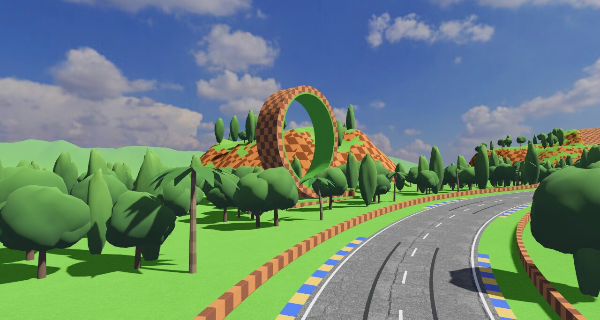

# Tracks

Motorust has three tracks, picked on the track select screen (see [gameplay.md](gameplay.md#screens)). All three are closed coastal roads with walls on both sides, slopes, crests where the bike takes off when you are flat out, and banked corners.

| Track | Length | In the game's words |
|---|---|---|
| [Bahía](#bahía) ("the Bay") | 1.6 km | "Una carretera junto al mar, con cuestas, peraltes y un salto en la recta de meta" (a seaside road with slopes, banking and a jump on the start straight) |
| [Turbo Bay](#turbo-bay) | 2.5 km | "Inspirada en Moto Racer: paseo marítimo, túnel bajo la propia pista, gran hotel, bosque y puente rojo" (inspired by *Moto Racer*: seafront, a tunnel under the track itself, grand hotel, forest and red bridge) |
| [Loops Hill](#loops-hill) | 2.1 km | "Inspirada en Sonic: colinas de tierra a cuadros, rizos, girasoles, tótems y cascadas" (inspired by Sonic: checkerboard hills, loops, sunflowers, totems and waterfalls) |

Distances below are in metres from the finish line, as in the track data.

## Bahía

Bahía is the first track: *Moto Racer*'s Speed Bay reimagined as a Mediterranean bay. It is a seaside road under a summer sky, with the sea to the west and south and mountains closing the horizon to the north-east. Its data is in `src/circuits/bay.rs`.

- **Scenery.**
  - Stone walls line the whole lap, with street lamps along it.
  - Walls of cut rock rise beside the road. On the start straight the rock is on the right and the sea on the left.
  - Umbrella pines, cypresses and olive trees.
  - Whitewashed houses and others in cream, ochre and pink.
  - Rocky outcrops inland and small islets offshore.
- **Start.** A red arch with a chequered board spans the finish line. The curbs are red and white.
- **Slopes.** About 200 m into the lap, the start straight crosses a crest where the bike jumps when you are flat out. The road then climbs to the high eastern side, about 18 m above the start, with rock on one side and a drop on the other. From there it runs back down to the finish.
- **Banking.** Corners bank according to how tight they are. This track has no extra banked spans.

## Turbo Bay


Turbo Bay is inspired by Speed Bay in *Moto Racer*. It is a figure of eight on a hilly island, with the sea all around and two bays cutting in towards the island's waist. The first loop runs clockwise, with the sea on the left; the second runs anticlockwise, with the sea on the right. Halfway round the lap, the road comes back over the ridge it went through in a tunnel. Its data is in `src/circuits/turbo_bay.rs`. The curbs are blue and white.

The coastline is drawn on its own (`Coast::Outline`), not as a distance from the road, so its bays, headlands and the river mouth under the bridge do not follow the track. Hills, a rocky ridge at the waist and islets offshore complete the island.


A lap, in order:

1. **The seafront** (start straight, 0–250 m, heading north). The blue "TURBO BAY" start arch spans the road, with a grandstand on the right.
   - On the left: a green railing with lamps, a beach with parasols, and the sea with striped buoys and boats.
   - On the right: palm trees and tall, brightly coloured hotels behind a hedge.
2. **Down to the water and into the tunnel** (about 250–625 m).
   - The seafront ends in a crest where the bike takes off.
   - A steep right-hander, heavily banked, drops almost to the water at the north-west point.
   - The road climbs east into a lit tunnel (505–625 m) through the ridge at the island's waist.
3. **The grand hotel and the rock pass** (about 625–990 m). Out of the tunnel, past palms and an old-style grand hotel on a headland above the south-east bay, to a pass between rocks with billboards and a red "CHECKPOINT" arch (960 m).
4. **The east coast road** (about 1000–1280 m). It runs behind a white concrete barrier, with the sea on the right. It is a roller coaster: a crest where the bike jumps with the sea straight ahead, a dip, and a long climb.
5. **The forest** (about 1300–1660 m). Tall trees line both sides of a long left-hander round the island's highest ground, 44 m above the start, and a second "CHECKPOINT" arch (1600 m). A lighthouse stands on the headland to the north.
6. **Over the tunnel** (about 1660–1900 m). The road runs down the ridge and crosses over the tunnel, about 18 m above the road inside it, on the grassy hill the tunnel goes through.
7. **The bay shore and the bridge** (about 1900–2255 m). The road runs down the shore of the south-east bay behind a concrete barrier to a bridge with red arches over the mouth of a river (2170–2255 m).
8. **The town** (about 2280 m to the finish). The road passes the town and its arcades, with rock on the right, and turns back onto the seafront.

## Loops Hill



Loops Hill is inspired by Green Hill, the first zone of *Sonic the Hedgehog*: a roller coaster of a road under a blue sky, running clockwise round an island of green hills with the sea all round. Its data is in `src/circuits/loops_hill.rs`, and its landmarks are drawn by `src/world/landmarks.rs`.

- **Scenery.**
  - Every cliff, rock wall and mesa is checkerboard earth: chocolate and caramel squares under a grass top. The walls along the road are low blocks of the same earth, with hedges on the start straight.
  - Palm trees, round broadleaf trees and rows of tall sunflowers turned towards the road.
  - Two giant loops, each on a block of checkerboard earth beside the road. They stand in the plane of the road, so you see them side on as you ride past, as in the original game.
  - Carved totem poles with eyes, beaks and wings.
  - Distant mountains across the sea to the north and west; to the south and east, open sea.
- **Start.** A blue "LOOPS HILL" arch with a grandstand on the right. The curbs are yellow and blue.
- **A lap, in order:**
  1. **The start straight** (0–290 m), north between palms and sunflowers. A crest at about 195 m makes the bike take off.
  2. **The first loop** (about 300–520 m). A long right-hander climbs past the first loop, on the outside, then S-bends roll on east over the hills to a red "CHECKPOINT" arch (700 m).
  3. **The tunnel** (770–870 m). The road climbs through a ridge of checkerboard earth in a tunnel lined with it, its highest point, 18 m above the start.
  4. **The waterfalls** (about 880–1230 m). Out of the tunnel, a waterfall pours down the rock wall on the left into a long right-hander banked like a velodrome. The road drops past a second waterfall, on the right.
  5. **The wooden bridge** (1230–1310 m). A deck of planks on log piers, with a wooden fence on each side, crosses an inlet where the sea runs in under the road.
  6. **The S-bends** (about 1340–1650 m). A crest, the second "CHECKPOINT" arch (1420 m), totem poles and the second loop, inland on the right.
  7. **The south shore** (1660–1960 m). A beach road with palms on the sea side and sunflowers on the other, a last jump at about 1775 m, and a banked right-hander back to the start.

## Editing or adding a track

### Where tracks live

Each track is a `Circuit` in `src/circuits/` (`bay.rs`, `turbo_bay.rs` and `loops_hill.rs`). A `Circuit` has four fields:

- `name`: shown on the track select screen.
- `description`: shown on the track select screen; `\n` breaks the line.
- `layout`: the road itself (a `Layout` from `src/track.rs`).
- `scenery`: everything around the road (a `Scenery` from `src/world/scenery.rs`).

`CIRCUITS` in `src/circuits/mod.rs` lists the tracks in the order the track select screen shows them. The first one is also the default track. To add a track:

1. Create a module next to the others that defines a `pub const` `Circuit`.
2. Declare the module in `src/circuits/mod.rs`.
3. Add the track to `CIRCUITS` and update the array length.

When a different track is picked, the world is rebuilt from its `Circuit` (see [architecture.md](architecture.md)).

### Layout

`Layout` (`src/track.rs`) describes the road:

- **`control_points`**: points in metres on the ground plane (`Vec2(x, z)`), in race order. The centre line is a closed centripetal Catmull-Rom curve through all of them, resampled every 2 m. The start is at the first point, and the start straight runs towards −Z.
- **`elevation`**: the height profile, as pairs of (metres from the finish line, road height in metres). The profile is closed and interpolated smoothly between pairs. Heights are added to a base level 2 m above the sea; every track starts the profile at 0 on the finish line.
- **`banking`**: banking comes automatically from curvature. The tighter the corner, the more the road tilts inwards, up to a fixed maximum. A `Banking { from, to, factor }` span multiplies it between two distances, still capped at the maximum. A factor above 1 banks more and below 1 banks less.

The road is 14 m wide plus curbs, and the walls stand 11.5 m from the centre line (`WALL_DISTANCE`).

The centre line may cross itself only where one stretch goes through a tunnel and the other passes well above it, at least 12 m higher, as in Turbo Bay. The physics follows each bike, its rider and the rivals on the stretch at their own level (`Track::nearest_at`), and the scenery takes care of the rest (see `tunnels` below).

The example below is illustrative and is not a real track. It shows a short loop with a crest on the start straight and an extra-banked hairpin:

```rust
use bevy::prelude::*;

use crate::track::{Banking, Layout};

const CONTROL_POINTS: [Vec2; 10] = [
    // Start straight, towards -Z.
    Vec2::new(0.0, 0.0),
    Vec2::new(0.0, -250.0),
    // Hairpin to the right.
    Vec2::new(40.0, -330.0),
    Vec2::new(130.0, -350.0),
    Vec2::new(210.0, -300.0),
    // Back straight and the last corners.
    Vec2::new(230.0, -200.0),
    Vec2::new(220.0, -60.0),
    Vec2::new(180.0, 40.0),
    Vec2::new(90.0, 70.0),
    Vec2::new(20.0, 50.0),
];

/// (metres from the finish line, height in metres).
const ELEVATION: [(f32, f32); 7] = [
    (0.0, 0.0),
    (120.0, 1.0),
    // Crest on the start straight: flat out, the bike jumps.
    (200.0, 6.0),
    (250.0, 3.5),
    (450.0, 2.0),
    (750.0, 10.0),
    (950.0, 3.0),
];

pub const LAYOUT: Layout = Layout {
    control_points: &CONTROL_POINTS,
    elevation: &ELEVATION,
    // The hairpin, with twice the banking its curvature gives it.
    banking: &[Banking {
        from: 260.0,
        to: 480.0,
        factor: 2.0,
    }],
};
```

In a real track, the layout goes straight into the `Circuit`, as in `turbo_bay.rs`: `layout: Layout { control_points: &CONTROL_POINTS, elevation: &ELEVATION, banking: &[...] }`.

### Scenery

`Scenery` (`src/world/scenery.rs`) is described mostly by **spans** of the lap. A span is `span(from, to)` in metres from the finish line. It may wrap past the finish line: `span(2440.0, 300.0)` covers the end of one lap and the start of the next. `LAP` is the whole lap. `Side::Left` and `Side::Right` are relative to the direction of the race.

| Field | What it describes |
|---|---|
| `coast` | Where the sea is. One of: `Coast::Function(f)`, a signed distance to the shore (positive inland); `Coast::AroundTrack(&[(along, distance)])`, an island with land inside the loop and, outside it, out to that many metres from the centre line at each point of the lap (a negative distance brings the sea in under the road, making an inlet for a bridge); or `Coast::Outline(&[Vec2])`, an island whose shore is a smooth closed curve through the given points, drawn like the centre line, with its own bays, headlands and inlets (draw an inlet under a bridge to bring the sea in under it). On an island, the land drops to the sea right beyond the walls where the shore is near. |
| `hills` | Height of the rolling hills (m). |
| `massifs` | Free-standing rock masses: `massif(x, z, radius, height)`. Also used for islets. |
| `cuttings` | Walls of cut rock beside the road: `Cutting { span, side, height }`. |
| `terraces` | Flat circular platforms at a given height, to stand a large building on. |
| `mountains` | A function for the distant mountains that close the horizon. |
| `curbs` | The two curb stripe colours. |
| `walls` | Wall style per span and side: `WallRun { span, side, style }`. `WallStyle` is `Stone` (the default everywhere else), `Concrete` (white barrier), `Railing` (green seafront railing), `Hedge` (hedge on a low wall) or `Checkered` (blocks of checkerboard earth). The first run that covers a point wins, so a run over `LAP` after the others sets the default. |
| `tunnels` | Spans that run through a tunnel. Another stretch of the track may pass over a tunnel (see [Layout](#layout)): there the ground stays down at the level of the tunnel, under its rock, and the rock carries the road above, just below its asphalt. Where the tunnel's top is gentle, grass grows on it unless the soil is checkerboard. |
| `bridges` | Spans carried by a bridge, built as `bridge_style` says: `RedArches` (a concrete deck under two red arches, with concrete walls) or `Wooden` (planks on log piers, with a wooden fence instead of walls). |
| `soil` | What cliffs, rock walls and the rock around tunnels are made of: `Soil::Rock` (natural rock with strata) or `Soil::Checkered` (Loops Hill's checkerboard earth, which also lines the tunnels). |
| `gantries` | Arches over the road: `Gantry { along, color, text }`. Without text they carry a chequered board. |
| `billboards` | Roadside signs: `Billboard { along, side, text, color, accent }`, where `accent` recolours the text from a given letter. |
| `lamps`, `palms`, `hotels` | Rows along the road: `Row { span, side, lateral, every }`, at `lateral` metres from the centre line, one every `every` metres. Hotels are tall and colourful. |
| `trees`, `forests` | Species of the scattered trees (umbrella pine, cypress, olive, broadleaf), and spans of dense forest with tall trees on both sides. |
| `houses` | `Houses { max, paints, spans }`: how many at most, their paint colours, and optionally the spans they are limited to. |
| `grand_hotel` | `Some((along, lateral))`: an old-style grand hotel at that point of the lap and signed distance from the road (positive to the left). |
| `buoys` | Positions of striped buoys in the sea. |
| `lighthouses` | Coastal lighthouses with striped towers, observation gallery and beacon: `Lighthouse { position, height }`. |
| `boats` | Sailboats and yachts anchored in the bay and open sea: `Boat { position, heading, kind }`. |
| `chevrons` | Curve warning arrow signs on sharp bends: `ChevronSign { along, side, direction }`. |
| `grandstands` | Covered spectator grandstands with crowds along the straights: `Grandstand { along, side, lateral, length }`. |
| `beach_parasols` | Striped beach umbrellas and loungers on the sand: `ParasolCluster { position, count }`. |
| `brake_markers` | Roadside braking countdown signs (100 m, 50 m) before corners: `BrakeMarker { along, side, distance }`. |
| `sunflowers` | Rows of tall sunflowers turned towards the road: `Row { span, side, lateral, every }`. They only grow on grass. |
| `totems` | Carved totem poles beside the road, facing it: `Totem { along, side }`. |
| `loops` | Giant loops on a block of checkerboard earth: `Loop { along, side, lateral, radius }`, with `lateral` the distance from the centre line to the middle of the loop. |
| `rings` | Lines of golden rings spinning over the road: `Rings { along, count, lateral, height }`, one every 6 m from `along`, `lateral` metres to the left of the centre line and `height` metres above the road. No track has them now. |
| `waterfalls` | Waterfalls with flowing water down the rock wall of a cutting: `Waterfall { along, side, width }`. Put a `Cutting` on that side first. |

### What `cargo test` checks

Run `cargo test` (or `make test`, see [building.md](building.md)) after any change. Every track in `CIRCUITS` is checked for the following:

- **No impossible corners.** Every corner radius is more than two and a half times the wall distance.
- **No self-crossing.** Distant stretches of the track never come close enough for their walls to meet; there must be room for scenery between them. The one exception is a stretch passing over a tunnel of another, at least 12 m above it.
- **Start.** The grid sits just behind the finish line, on the Z axis, facing down the start straight towards −Z. Every track starts at the origin.
- **Rideable slopes and banking.** Slopes stay under 13 %, banking stays within its maximum, and the tight corners do have banking.
- **Terrain.** The terrain neither covers the road nor leaves a gap under it, except on bridges and where the road passes over a tunnel, and the road never touches the sea.
- **Houses.** At least half of `houses.max` find a place to stand.
- **A rival can do a lap.** An AI rival completes a lap within 90 seconds without leaving the road.
- **A flat-out lap.** Full throttle, never braking and only steering towards the road ahead, completes a lap within 60 seconds without touching the walls and stays almost entirely on the asphalt.
- **Landmarks.** No loop's block comes within 2 m of the walls, rings float over the asphalt within reach of a bike, and every waterfall pours down a rock wall more than 6 m high.
- **Short jumps.** Each jump lasts under 0.75 s and rises less than 1.3 m, and flat out a rival does take off over the crests (at least twice in 70 seconds).

Some tests cover a single track: for example, that Bahía has sea to the west and mountains to the north-east; that Turbo Bay is an island with its bays and a river under the bridge, that its banked span banks more than its curvature alone would, and that it passes over its own tunnel, with each level found by the bikes on it and the ground kept down under the tunnel's rock; and that Loops Hill is an island of checkerboard cliffs with the sea under its wooden bridge.
